# Allineamento Tecnico di Sistema — M0V3 Analytics Enterprise

Questo documento raccoglie in modo strutturato e puntuale l'intero avanzamento tecnico, architetturale, statistico e funzionale della piattaforma, aggiornato al **10 Novembre 2026** per la sincronizzazione completa con **Google Gemini**.

---

## 1. Mappa Architetturale Aggiornata

```mermaid
flowchart TD
    subgraph Core ["Core Piattaforma & Design System M0V3"]
        A["app.py & config.py<br/>Routing, Session Hardening, RBAC & Stile"]
        U["utils.py<br/>Master Timeline, Hero Strip, ACWR & Caching RAM"]
        UTM["utils_tennis_matches.py & utils_livetennis.py<br/>Parser Match ATP/ITF, Ingestione Dati & Sync Live"]
        P["pdf_generator.py<br/>Motore Vettoriale ReportLab Landscape A4<br/>(Export Trend Stagionale & Sessioni)"]
    end

    subgraph ModuliEsecutivi ["Moduli Operativi & Analitici"]
        H["views/home.py<br/>Locker Room, Roster Overview, Player Focus & Live KPI"]
        SM["views/statistiche_match.py<br/>Match Ufficiali ATP, Benchmark W/L,<br/>Correlazione Telemetria GPS & Metriche Per-Point"]
        M_STAG["views/trend_stagionale.py<br/>Timeline Annuale, Shading Superfici (Terra/Cemento/Erba),<br/>Etichette Verticali Tornei & Trend Carico/Monotonia"]
        M_SETT["views/trend_settimanale.py<br/>Trend Settimanale Rolling, Benchmark vs Medie & Distribuzione Giornaliera"]
        M_MED["views/medie.py<br/>Benchmark, Testa a Testa, Ranking & Distribuzione Lavoro"]
        M1["views/atleta_mobile.py<br/>Mini Webapp Smartphone (sRPE, Wellness & Bilingue)"]
        M2["views/test_fisici.py & manuale_test.py<br/>Valutazione Neuromuscolare, SWC & PB Radar"]
        M3["views/calendario_medico.py<br/>Master Calendar, Registro Clinico & Matrice Preventiva"]
        AM["views/analisi_match.py & views/storico_match.py<br/>Analisi Singolo Match & Storico GPS"]
        AS["views/analisi_sessione.py<br/>Analisi Sessioni di Allenamento (Filtro Esclusione Match)"]
    end

    subgraph DataLayer ["Data Layer (Supabase PostgreSQL, Parquet & File Supporto)"]
        DB1[("wellness_mattutino & rpe_sessioni")]
        DB2[("catalogo_protocolli & sessioni_test")]
        DB3[("registro_medico_fisio")]
        DB4[("database_storico.parquet & .csv (Master GPS Sessions)")]
        DB5[("cobolli_matches.parquet (Archivio Match ATP Ufficiali)")]
        DB6[("match_gps_links.json (Abbinamenti Manuali Match-GPS)")]
    end

    A --> H & SM & M_STAG & M_SETT & M_MED & M1 & M2 & M3 & AM & AS
    U --> DB1 & DB2 & DB3 & DB4
    UTM --> DB5 & DB6
    SM --> DB4 & DB5 & DB6
    M_STAG --> DB4 & P
    H --> DB3 & DB4
    M1 --> DB1
    M2 --> DB2
    M3 --> DB3 & DB4
```

---

## 2. Avanzamenti e Nuove Feature di Sistema (Upgrade Novembre 2026)

### A. Integrazione Dati Match Ufficiali ATP/ITF (Focus Atleta: Flavio Cobolli)
È stato integrato il modulo completo per la gestione delle partite ufficiali ATP/ITF partendo dal file storico master [`data_supporto/STORICO MATCH COBOLLI.xlsx`](file:///Users/riccardodimaio/webapp_tennis_gps/data_supporto/STORICO MATCH COBOLLI.xlsx) convertito nel dataset ottimizzato [`data_supporto/cobolli_matches.parquet`](file:///Users/riccardodimaio/webapp_tennis_gps/data_supporto/cobolli_matches.parquet):
- **Oltre 450 match punto-per-punto censiti**: Punti totali disputati (`total_points`), Punti al servizio, % Punti vinti sulla prima e seconda, Ace, Doppi falli, Ace avversario, Durata ufficiale ATP, Risultato (Vittoria/Sconfitta), Punteggio dettagliato, Superficie (`Hard`, `Clay`, `Grass`), Turno e Ranking avversario.
- **Supporto Live Tennis API & Sync Giornaliero**: Modulo [`utils_livetennis.py`](file:///Users/riccardodimaio/webapp_tennis_gps/utils_livetennis.py) e script stand-alone [`sync_livetennis.py`](file:///Users/riccardodimaio/webapp_tennis_gps/sync_livetennis.py) per il recupero dei dati delle partite future e caching locale in JSON.

---

### B. Nuova Pagina "Statistiche Match" con Correlazione Tennis ↔ GPS
La pagina [`views/statistiche_match.py`](file:///Users/riccardodimaio/webapp_tennis_gps/views/statistiche_match.py) introduce un sistema di analisi incrociata tra la prestazione tecnica del match e la telemetria fisica rilevata dal tracker GPS:

1. **Tab 1 — Analisi Prestazione Tennis ↔ GPS**:
   - **Costo Fisico del Punto (Metriche "Per Point")**:
     - *Metri per Punto (`m/pt`)*: distanza reale percorsa normalizzata su ogni singolo punto giocato (media reale: **~31.6 m/pt** su match singoli).
     - *Training Load / Punto (`TL/pt`)*: costo metabolico medio per punto (**~18.6 TL/pt**).
     - *Player Load / Punto (`PL/pt`)*: stress meccanico e impatto neuromuscolare triassiale per punto (**~2.48 PL/pt**).
     - *Acc + Dec High / Punto*: frequenza media di cambi di direzione e frenate brusche per punto (**~1.86 azioni/pt**).
   - **Nuovo Grafico a Barre Cronologiche Metri per Punto**:
     - Elimina l'effetto ragnatela e le linee incrociate tra punti non contigui: ogni match singolo è rappresentato da una barra verticale distinta.
     - **Verde Smeraldo (`#10b981`)** per le Vittorie, **Rosso Corallo (`#ef4444`)** per le Sconfitte.
     - **Linea tratteggiata orizzontale**: Media complessiva stagionale.
     - **Linea continua morbida (Spline)**: Media Mobile a 3 match (*3-Match Rolling Trend*) che evidenzia l'andamento reale dell'intensità nel corso della stagione.
     - **Hover Dettagliato**: Torneo, Superficie, Avversario, Punteggio, Metri/Punto, Distanza totale (m), Punti disputati, Durata e Training Load.
   - **Benchmark Prestativo Vittorie vs Sconfitte**:
     - Tabella comparativa con differenziali percentuali: evidenzia che nelle vittorie Flavio percorre in media più metri per punto (**+9.3%**) e sostiene un Training Load superiore del **+13.1%**, confermando come la capacità di allungare lo scambio sia direttamente correlata al successo.
     - Grafico a barre raggruppate Plotly per visualizzare istantaneamente il profilo fisico per esito.
   - **Impatto della Superficie (Terra vs Cemento vs Erba)**:
     - Card KPI dedicate per superficie (Clay terracotta, Hard blu, Grass smeraldo) e scatter plot biomeccanico *Metri/Punto vs Decelerazioni High IMU*.
   - **Difficoltà Avversario (Ranking Tier & Top Stress Matches)**:
     - Scatter plot *Ranking Avversario vs Training Load* con colore per esito e dimensione per punti totali.
     - Classifica automatica dei **Top 5 Match a Massimo Logoramento Meccanico**.
   - **Efficienza del Servizio vs Risparmio Fisico**:
     - Correlazione lineare calcolata con NumPy (`np.polyfit`) tra Ace disputati e Metri per Punto.
     - Confronto tra giornate di servizio dominante ($\ge 6$ Ace) vs servizio normale ($< 6$ Ace), dimostrando una netta riduzione del carico eccentrico sulle frenate e un Win Rate significativamente superiore.

2. **Tab 2 — Archivio Partite & Abbinamento Telemetria**:
   - Paginazione rapida dei match singoli, badge di stato telemetria (`GPS REALE`, `GPS MANUAL`, `NO GPS`), espansori con dettaglio tecnico completo, abbinamento manuale e pulsante di download del dataset in formato `.csv`.

---

### C. Rigorosa Politica di Qualità Dati: Match Singoli & Dati 100% Reali
- **Esclusione Categorica dei Dati Simulati/Autocreati**:
  - Il sistema esclude rigorosamente da tutti i calcoli correlati qualsiasi sessione contrassegnata con `Dato_Simulato == True`, sessioni con asterisco `*` nel nome, o file generati dal simulatore (`File_Name == 'Generato_dal_Sistema_M0V3'`).
- **Filtro Rigoroso sui Match Singoli**:
  - Sia sul lato match ufficiali (`type == 'Singolare'`) sia sul lato GPS (`Tipologia Sessione == 'Match'`), l'intero ecosistema delle statistiche match si concentra esclusivamente sulle prestazioni di singolare, eliminando qualsiasi distorsione dovuta a match di doppio o allenamenti.

---

### D. Trend Stagionale con Shading Superfici, Tornei e Label Verticali
Nel modulo [`views/trend_stagionale.py`](file:///Users/riccardodimaio/webapp_tennis_gps/views/trend_stagionale.py):
- **Evidenza Visiva del Torneo Giocato**:
  - Tutti i grafici stagionali (Tempo Match, Tempo Totale, Training Load, % TL High, ACWR, Monotonia, Strain) mostrano ora le colonne ombreggiate verticali con il colore della superficie su cui si disputava il torneo:
    - **Terra Rossa (Clay)**: `#ea580c`
    - **Erba (Grass)**: `#059669`
    - **Cemento (Hard)**: `#0284c7`
- **Etichette Verticali `-90°` per Evitare Sovrapposizioni**:
  - Sull'asse X, le etichette con il nome del torneo e il tag di gara (es. `Madrid [S]`, `Roland Garros [S]`, `Cincinnati [S+D]`) sono posizionate verticalmente a `-90°`, garantendo perfetta leggibilità anche a stagione inoltrata con oltre 40 settimane di gara.
- **Filtro Stretto sul Tempo Match**:
  - Il tempo e il conteggio dei soli match filtrano rigorosamente `Tipologia Sessione.isin(['match', 'match doppio'])`. Le settimane senza tornei o con soli allenamenti indicano ora esattamente `0h 00m` di match.

---

### E. Nuovo Motore Esportazione PDF Stagionale Vettoriale (`crea_pdf_stagionale_m0v3`)
In [`pdf_generator.py`](file:///Users/riccardodimaio/webapp_tennis_gps/pdf_generator.py):
- Ridisegnato l'intero motore di generazione PDF per l'analisi stagionale (`crea_pdf_stagionale_m0v3`) per riprodurre fedelmente la grafica e il layout del portale web:
  - Grafici vettoriali ad alta risoluzione (scala 1.5x, rendering ReportLab).
  - Curve spline con palette colori identica alla webapp (`#f97316` match time, `#0ea5e9` tempo totale, `#6366f1` TL, `#ef4444` % TL High, `#0284c7` ACWR, `#10b981` Monotonia, `#f59e0b` Strain).
  - Shading verticale colorato per superficie, label a `-90°` e banner con legenda superfici.
  - Tabelle Dark Navy riassuntive e generazione del documento in meno di 8 secondi.

---

### F. Hardening Sicurezza Sessioni, Auth & Resilienza Cross-Platform
1. **Prevenzione `AttributeError: 'NoneType' object has no attribute 'email'`**:
   - In [`app.py`](file:///Users/riccardodimaio/webapp_tennis_gps/app.py), inserito il blocco di controllo preventivo con `return` immediato in caso di sessione non valida o utente nullo.
   - Accesso difensivo tramite `getattr(user_obj, 'email', '')` e `getattr(user_obj, 'id', '')` su tutte le viste dell'applicazione.
2. **Rimozione della Dipendenza Esterna `statsmodels`**:
   - Sostituito il calcolo delle linee di regressione in Plotly Express con **NumPy nativo** (`np.polyfit`), prevenendo crash `ModuleNotFoundError` sia in locale che in cloud.
3. **Armonizzazione Filtri Sessioni in [`views/analisi_sessione.py`](file:///Users/riccardodimaio/webapp_tennis_gps/views/analisi_sessione.py)**:
   - Esclusione rigorosa sia di `'match'` che di `'match doppio'` dall'analisi delle sessioni di allenamento.
4. **Armonizzazione Riconoscimento Match in [`views/atleta_mobile.py`](file:///Users/riccardodimaio/webapp_tennis_gps/views/atleta_mobile.py)**:
   - Sostituita la ricerca generica per stringa con il controllo rigoroso `Tipologia Sessione.isin(['match', 'match doppio'])`.
5. **Compatibilità Cross-Platform Windows / Mac / Linux**:
   - Typography con font stack universale (`'Inter', -apple-system, BlinkMacSystemFont, 'Segoe UI', Roboto, sans-serif`).
   - Scrittura e lettura di tutti i file in encoding esplicito `utf-8`.
   - Percorsi agnostici rispetto al sistema operativo tramite `os.path.join`.

---

## 3. Riepilogo File del Repository & Stato Operativo

| File | Percorso | Stato | Descrizione Funzionale |
| :--- | :--- | :--- | :--- |
| `app.py` | [`app.py`](file:///Users/riccardodimaio/webapp_tennis_gps/app.py) | **Operativo** | Main entrypoint, router, session guard, RBAC e sidebar unificata. |
| `config.py` | [`config.py`](file:///Users/riccardodimaio/webapp_tennis_gps/config.py) | **Operativo** | Design system M0V3, palette colori, card KPI, metriche e dizionario bilingue. |
| `utils.py` | [`utils.py`](file:///Users/riccardodimaio/webapp_tennis_gps/utils.py) | **Operativo** | Gestione database, cache Parquet/RAM, Hero strip atleti, ACWR, calcoli matematici. |
| `utils_tennis_matches.py` | [`utils_tennis_matches.py`](file:///Users/riccardodimaio/webapp_tennis_gps/utils_tennis_matches.py) | **Operativo** | Ingestione, normalizzazione e caching dell'archivio match ATP/ITF punto-a-punto. |
| `utils_livetennis.py` | [`utils_livetennis.py`](file:///Users/riccardodimaio/webapp_tennis_gps/utils_livetennis.py) | **Operativo** | Client per integrazione e sync live dei match futuri. |
| `pdf_generator.py` | [`pdf_generator.py`](file:///Users/riccardodimaio/webapp_tennis_gps/pdf_generator.py) | **Operativo** | Motore ReportLab landscape ad alte prestazioni (Report Sessioni, Medie, Stagionale). |
| `views/statistiche_match.py` | [`views/statistiche_match.py`](file:///Users/riccardodimaio/webapp_tennis_gps/views/statistiche_match.py) | **Operativo** | Statistiche match ufficiali ATP, 5 moduli analitici correlati Tennis ↔ GPS, nuovo grafico a barre cronologiche metri/punto e archivio con abbinamento. |
| `views/trend_stagionale.py` | [`views/trend_stagionale.py`](file:///Users/riccardodimaio/webapp_tennis_gps/views/trend_stagionale.py) | **Operativo** | Trend annuale con tornei, shading superfici (Terra/Cemento/Erba) e label a -90°. |
| `views/trend_settimanale.py` | [`views/trend_settimanale.py`](file:///Users/riccardodimaio/webapp_tennis_gps/views/trend_settimanale.py) | **Operativo** | Monitoraggio settimanale rolling e di calendario, benchmark giornaliero. |
| `views/home.py` | [`views/home.py`](file:///Users/riccardodimaio/webapp_tennis_gps/views/home.py) | **Operativo** | Dashboard executive, stato clinico, trend 30gg bivalente e sessioni recenti. |
| `views/medie.py` | [`views/medie.py`](file:///Users/riccardodimaio/webapp_tennis_gps/views/medie.py) | **Operativo** | Medie, H2H, Ranking Roster e Distribuzione Lavoro con periodo personalizzato. |
| `views/analisi_match.py` | [`views/analisi_match.py`](file:///Users/riccardodimaio/webapp_tennis_gps/views/analisi_match.py) | **Operativo** | Analisi dettagliata match singolo GPS con densità su 60 minuti e filtro superficie. |
| `views/storico_match.py` | [`views/storico_match.py`](file:///Users/riccardodimaio/webapp_tennis_gps/views/storico_match.py) | **Operativo** | Timeline storica match GPS, densità oraria e normalizzazioni. |
| `views/analisi_sessione.py` | [`views/analisi_sessione.py`](file:///Users/riccardodimaio/webapp_tennis_gps/views/analisi_sessione.py) | **Operativo** | Analisi singola seduta di allenamento (con esclusione rigorosa match). |
| `views/carico_interno.py` | [`views/carico_interno.py`](file:///Users/riccardodimaio/webapp_tennis_gps/views/carico_interno.py) | **Operativo** | Monitoraggio sRPE, pure I:E ratio per slot tennis e Lag Effect 24h. |
| `views/test_fisici.py` | [`views/test_fisici.py`](file:///Users/riccardodimaio/webapp_tennis_gps/views/test_fisici.py) | **Operativo** | Test neuromuscolari, radar PB, readiness SWC e asimmetrie direzionali. |
| `views/calendario_medico.py` | [`views/calendario_medico.py`](file:///Users/riccardodimaio/webapp_tennis_gps/views/calendario_medico.py) | **Operativo** | Master Calendar, registro fisio, alert overload >70% TL e matrice preventiva. |
| `views/atleta_mobile.py` | [`views/atleta_mobile.py`](file:///Users/riccardodimaio/webapp_tennis_gps/views/atleta_mobile.py) | **Operativo** | Interfaccia mobile-first smartphone per inserimento sRPE e questionario wellness. |

---

## 4. Specifiche di Deployment & Manutenzione Continua
- **Repository Git Ufficiale di Produzione**: [https://github.com/RDMTRAINING/MOV3-Analytics.git](https://github.com/RDMTRAINING/MOV3-Analytics.git)
- **Branch Attivo**: `main`
- **Deploy Automatico**: Streamlit Cloud traccia il branch `main` e distribuisce i commit in push continuo.
- **Ambiente Python Consigliato**: Python 3.9 o superiore.
- **Cache Invalidation**: Ogni modifica al database richiama `clear_database_cache()`, forzando il reload istantaneo senza necessità di riavviare il server.
