# ATLANTE INTEGRALE DELLE PAGINE E SOTTOPAGINE — MOV3 ANALYTICS ENTERPRISE
**Documentazione Architetturale, Funzionale e Scientifica Completa di tutte le Schermate, Viste, Schede, Sottoschede, Formule ed Esportazioni della WebApp**

- **Piattaforma:** M0V3 Analytics Enterprise v3.0 (`https://github.com/RDMTRAINING/MOV3-Analytics.git`)
- **Architettura:** 35 moduli Python, Design System **Dark Cockpit Executive (Zero-Emoji Policy)**, Storage **Local-Parquet Partizionato per Atleta (`data_cache/athletes/{slug}.parquet` + `manifest.json`) + Cloud Binary Snapshot Zero-Latency (Supabase)**, Motore Predittivo **What-If Microcycle Simulator**, **Biometria Passiva Wearable (HRV / RHR / Sonno)**, **Proactive Morning Digest Engine (GitHub Actions 09:30 CET)**, Bilinguismo **IT / EN**.
- **Ruoli di Sistema:** `Super-Admin`, `Coach`, `Staff`, `Fisio / Medico`, `Atleta`.
- **Data Redazione:** 20 Novembre 2026 (Upgrade Enterprise v3.0)

---

## INDICE GENERALE DELL'ARCHITETTURA DI NAVIGAZIONE

```mermaid
flowchart TD
    A["Accesso Piattaforma (app.py)"] --> B["1.1 Login Cockpit & Recupero Password"]
    B --> C["1.2 Clickwrap GDPR Art. 9 & Tutela IP (M0V3_IP_GDPR_v2.0)"]
    C --> D{"1.3 Auto-Router Dispositivo & Ruolo"}
    D -->|"Smartphone / Ruolo Atleta"| E["Vista Mobile: AREA ATLETA M0V3 MOBILE (views/atleta_mobile.py)"]
    D -->|"Desktop / Staff & Admin"| F["Shell Desktop & Sidebar Enterprise (22 Voci di Menu)"]

    F --> G1["AREA 1: Plancia Direzionale & Diario"]
    F --> G2["AREA 2: Telemetria GPS & Analisi Prestativa Tennis"]
    F --> G3["AREA 3: Carico Interno, Test Fisici & Area Medica"]
    F --> G4["AREA 4: Data Ingestion, Simulazione & Governance"]
    F --> G5["AREA 5: Enciclopedie Scientifiche, Help Desk, Profilo & Regia Admin"]

    G1 --> P1["1. Dashboard Home (views/home.py)"]
    G1 --> P2["2. Diario Wellness & sRPE (views/atleta_mobile.py)"]

    G2 --> P3["3. Analisi Match (views/analisi_match.py — 4 Sub-Tab)"]
    G2 --> P4["4. Analisi Sessione (views/analisi_sessione.py — 4 Sub-Tab)"]
    G2 --> P5["5. Trend Settimanale (views/trend_settimanale.py — 5 Master Tab + 5 Sub-Tab)"]
    G2 --> P6["6. Trend Stagionale (views/trend_stagionale.py — 8 Master Tab)"]
    G2 --> P7["7. Storico Match (views/storico_match.py — 4 Sub-Tab)"]
    G2 --> P8["8. Statistiche Match Tennis ↔ GPS (views/statistiche_match.py — 2 Tab, 6 Sezioni)"]
    G2 --> P9["9. Medie & Confronti (views/medie.py — 7 Master Tab)"]

    G3 --> P10["10. Analisi Wellness-RPE-GPS (views/carico_interno.py — 3 Sub-Tab)"]
    G3 --> P11["11. Test & Valutazioni (views/test_fisici.py — 6 Master Tab + 3 Sub-Tab)"]
    G3 --> P12["12. M0V3 Tennis Test (views/move_tennis_test.py — 3 Master Tab + 2 Sub-Tab)"]
    G3 --> P13["13. Medico & Extra Tennis (views/calendario_medico.py — 3 Master Tab)"]

    G4 --> P14["14. Caricamento Dati CSV (views/caricamento_dati.py)"]
    G4 --> P15["15. Generatore Dati No-GPS (views/generatore_dati.py)"]
    G4 --> P16["16. Gestione File & Data Governance GDPR (views/gestione_file.py — 2 Master Tab)"]

    G5 --> P17["17. Manuale Report (views/manuale_report.py — 63+ Moduli)"]
    G5 --> P18["18. Manuale Test (views/manuale_test.py — 22+ Protocolli)"]
    G5 --> P19["19. Supporto & Assistenza (views/supporto.py — 2 Sub-Tab)"]
    G5 --> P20["20. Profilo Personale & Diritto all'Oblio (views/profilo.py)"]
    G5 --> P21["21. To-Do Tagli K-Sport Kanban (views/admin.py)"]
    G5 --> P22["22. Pannello Super-Admin (views/admin.py — 7 Master Tab)"]
```

---

## SEZIONE 0 — SHELL GLOBALE, AUTENTICAZIONE, GATE LEGALE E SIDEBAR (`app.py`, `config.py`)

### 0.1 Schermata di Login (`auth_module()` in `app.py`)
- **Accessibilità:** Pubblica (utenti non autenticati).
- **Persistenza Sessione Anti-Reload:** Ripristina automaticamente la sessione tramite `localStorage` e cookie `m0v3_rt` (validità 30 giorni) con auto-refresh trasparente del token JWT (`ensure_valid_session()` e interceptor PostgREST su errore `PGRST303`).
- **Componenti Interattivi:**
  - **Selettore Lingua (`IT` / `EN`)** in alto a destra nella card glassmorphism.
  - **Form di Login (`login_form`)**: Campi `Email` e `Password` ottimizzati per autofill nativo iOS/Chrome/Safari + pulsante primario `"Accedi"` / `"Sign In"`.
  - **Sotto-sezione Expander `"Password dimenticata?"` / `"Forgot password?"`**: Campo email + pulsante `"Invia richiesta a M0V3"` che registra la richiesta nella tabella Supabase `richieste_reset` per il Super-Admin.

### 0.2 Gate Obbligatorio al Primo Accesso — Clickwrap GDPR & Proprietà Intellettuale (`app.py`)
- **Attivazione:** Compare subito dopo il login se `has_accepted_terms` o `privacy_accettata` è `False`. Blocca la navigazione finché l'utente non firma digitalmente l'accordo (`M0V3_IP_GDPR_v2.0`).
- **Contenuto Normativo (3 Clausole):**
  1. *Proprietà Intellettuale e Licenza d'Uso Limitata* (tutela algoritmi proprietari Riccardo Di Maio — M0V3 S.r.l.: Readiness SWC, Pure I:E Ratio, Metriche Per-Point, ACWR Uncoupled EWMA, ripartizione biomeccanica 70/30).
  2. *Trattamento dei Dati Sensibili, Biometrici e Sanitari (Art. 9 Reg. UE 2016/679 - GDPR)*.
  3. *Sicurezza delle Credenziali e Tracciabilità Forense* (watermarking identificativo dell'account su ogni PDF esportato).
- **Azioni & Esportazioni:**
  - Pulsante download `"Scarica l'Informativa Completa Privacy & Proprietà Intellettuale M0V3 (PDF)"` (`Atto_Privacy_IP_MOV3_v2.pdf`).
  - Checkbox obbligatoria di presa visione e accettazione.
  - Pulsante primario `"Accedi alla Piattaforma"` (registra su Supabase `has_accepted_terms=True`, `terms_accepted_at`, `terms_version="M0V3_IP_GDPR_v2.0"`) e pulsante secondario `"Esci / Logout"`.

### 0.3 Sidebar Enterprise & Selettore Atleta Globale (`app.py`)
- **Header Fisso Sticky (`sidebar_fixed_header`)**:
  - Logo circolare M0V3.
  - **Selettore Atleta Globale (`Atleta Attivo` / `Active Athlete`)**: Menu a tendina per `Super-Admin`, `Coach`, `Staff`, `Fisio / Medico` (filtrato tramite RLS sugli atleti associati al profilo) oppure badge fisso `"Atleta Profilato"` per il ruolo `Atleta`. Propaga la selezione dell'atleta a tutte le pagine della webapp.
  - **Pulsante Rapido Digital Handshake (`Segnala GPS da Tagliare su K-Sport`)**: Visibile a Staff/Coach/Super-Admin abilitati; apre da qualsiasi pagina la finestra modale `@st.dialog` per inviare una richiesta di taglio sessione GPS alla coda Kanban K-Sport.
- **Corpo Scorrevole della Sidebar:**
  - Selettore Lingua Globale (`IT` / `EN`).
  - Card Utente Loggato (`Email` + `Ruolo`).
  - **Menu di Navigazione Dinamico (`option_menu`)**: Filtra in tempo reale le 22 voci di menu nascondendo automaticamente le aree/pagine disabilitate dal Super-Admin per quello specifico utente (e bloccando sempre l'area medica al ruolo `Atleta`).
  - **Badge Diagnostico `"Cloud Snapshot Attivo"`**: Mostra l'ultima data GPS salvata e il totale righe consolidate + pulsante `"Scarica database_storico.parquet Consolidato"` (per Super-Admin).
  - Pulsante `"Vista Smartphone"` / `"Smartphone View"`, pulsante `"Logout"` e footer istituzionale di copyright.
- **Banner Giornaliero Desktop per Ruolo Atleta:** Quando un utente con ruolo `Atleta` naviga in modalità Desktop, in cima ad ogni pagina compare una barra di stato live (`Wellness: Compilato / Da compilare` e `sRPE: Registrato / Da registrare`) con pulsante rapido per aprire il `"Diario Wellness & sRPE"`.

---

## PAGINA 1 — DASHBOARD HOME (`views/home.py`)
- **Titolo UI:** `Executive Locker Room` (Menu: `Dashboard Home` / `Home Dashboard`)
- **Chiave Rotta & File:** `"Home"` → `views/home.py` (`render_home(t)`)
- **Ruoli Autorizzati:** Tutti i ruoli autenticati (dati filtrati per gli atleti associati).

### Sotto-sezioni e Moduli della Pagina:
1. **Banner Notifica Digital Handshake — Coda Tagli GPS** *(solo Super-Admin, Coach, Staff)*:
   - Appare automaticamente quando ci sono sessioni GPS in attesa di ritaglio su K-Sport (`n_pen > 0`), mostrando il conteggio e il pulsante diretto `"Gestisci Coda Tagli"` che porta alla To-Do List Kanban.
2. **Blocco `FOCUS ATLETA & MONITORAGGIO INDIVIDUALE`**:
   - **Header Focus Atleta**: Pill dell'atleta attivo + pulsante `"Segnala GPS da Tagliare su K-Sport"`.
   - **Grande Hero Card Atleta**:
     - Avatar monogramma con iniziali, nome atleta, data e titolo dell'ultima sessione GPS, numero totale di sessioni nel database.
     - **Semaforo Stato Clinico & Idoneità Operativa** (`_calcola_stato_clinico_atleta`):
       - `DISPONIBILE · Full Training` (Verde)
       - `CARICO ADATTATO · Modificato / RTP` (Ambra — include un **allarme automatico `OVERLOAD >70% MEDIA`** se l'ultimo Training Load GPS supera il 70% della media storica dell'atleta durante un periodo di carico limitato)
       - `STOP MEDICO · Indisponibile` (Rosso, con distretto anatomico, VAS e data rientro stimata)
       - `VIAGGIO / RIPOSO · Off` (Blu)
     - **Card `ULTIMO TRATTAMENTO FISIOTERAPICO`** (`_calcola_ultimo_trattamento_atleta`): Nome terapia (es. Tecarterapia, Terapia Manuale), data, giorni trascorsi (`Oggi`, `Ieri`, `N gg fa`), distretto anatomico, lato e scala dolore VAS.
3. **Blocco `STATISTICHE ATP TOUR (LIVE API)`**:
   - Sincronizzato con il motore LiveTennis API (con badge timestamp ultimo sync).
   - **4 Scorecard ATP**:
     1. `RANKING ATP LIVE`: Posizione ufficiale `#Rank` e punti ATP.
     2. `CLUTCH: TIEBREAK`: Percentuale vittorie tiebreak in carriera e record `W - L`.
     3. `SET DECISIVI (3°/5° SET)`: Percentuale vittorie al set decisivo e record `W - L`.
     4. `VS MANCINI`: Win rate contro avversari mancini.
4. **Blocco `CALENDARIO & MASTER TIMELINE INTEGRATA (FOCUS ATLETA)`**:
   - Integra direttamente nella Home il calendario mensile interattivo (`render_master_timeline` da `views/calendario_medico.py`):
     - Navigazione mese (`< Mese Prec.`, `Oggi / Mese Corrente`, `Mese Succ. >`, selettori Anno e Mese).
     - **5 KPI Card Mensili**: `Sessioni GPS & Campo`, `Carico Soggettivo (sRPE)`, `Readiness Wellness Media`, `Eventi Clinici & Fisio`, `Giorni Indisponibilità`.
     - **Griglia Calendario Mensile a 7 Colonne**: Ogni casella giornaliera fonde 5 flussi dati: sfondo cromatico dello stato clinico, sessioni GPS (`TL`, minuti, superficie, badge `[SIM]`), sessioni sRPE (`AU` e badge riconciliazione Staff), sessioni Extra-Campo Palestra/Fisico (stimolo `70/30`), pill Wellness mattutino (`1-10`), badge Fisioterapia/Fastidi e tooltip completo all'hover.
     - **Ispettore Giornaliero (`Ispeziona`)**: Cliccando su un giorno si apre il dettaglio completo di tutte le attività svolte in quella data (con pulsante ponte verso `"Generatore Dati (No GPS)"` se è presente un sRPE Tennis senza file GPS).
5. **Blocco `ROSTER READINESS & ACWR OVERVIEW`**:
   - Tabella HTML direzionale sull'intero parco giocatori visibile:
     - `Atleta & Ultima Sessione` (data, nome, tipologia, eventuale tag `SIM`)
     - `Stato Dati` (`OGGI`, `IERI`, `N gg fa`)
     - `Readiness 2 Giorni (Acute Load)`: Carico acuto 48h vs baseline 28 giorni (`% ACWR 2gg`, delta %, barra con tacca 100%)
     - `Carico 7 Giorni (7-Day Rolling)`: Carico rolling 7gg vs baseline 28 giorni (`% ACWR 7gg`, delta %, barra con tacca 100%)
     - `Settimana Corrente (Lun-Dom)`: Training Load cumulato da lunedì, numero sessioni e minuti totali.
6. **Blocco `TREND CARICHI ULTIMO MESE ROLLING (30 GIORNI)`**:
   - **4 Mini KPI Card (30gg)**: `Training Load Totale (30gg)`, `TL High Totale (Neuromuscolare)`, `Rapporto Intensità / Volume (TL High / TL %)`, `Giorni con Attività (/ 30 gg)`.
   - **Grafico Plotly a Doppio Asse Y (`fig_roll`)**: Barre raggruppate giornaliere su 30 giorni con `Training Load (Volume)` sull'asse Y1 sinistro e `Training Load High (Intensità)` sull'asse Y2 destro.
7. **Barra `Accesso Rapido Funzionalità Operative` (Quick Launch)**:
   - 5 pulsanti rapidi: `Carica Nuovi CSV`, `Generatore (No GPS)`, `Gestione File DB`, `Medie & Roster`, `Manuale REPORT`.

---

## PAGINA 2 — VISTA SMARTPHONE ATLETA & DIARIO WELLNESS / sRPE (`views/atleta_mobile.py`)
- **Titolo UI:** `AREA ATLETA · M0V3 MOBILE` (Menu Desktop per Atleta: `Diario Wellness & sRPE` / `Wellness & sRPE Diary`)
- **Chiave Rotta & File:** `"Diario Atleta"` (Desktop) oppure Auto-Routing Mobile (`?device=mobile`) → `views/atleta_mobile.py` (`render_atleta_mobile(t)`)
- **Ruoli Autorizzati:** `Atleta` (utente primario) + `Super-Admin`, `Coach`, `Staff` (con selettore `"Modalità Test Coach — Seleziona Atleta"` per ispezionare o inserire dati per conto di qualsiasi giocatore).
- **Controlli Superiori:** Switch lingua `IT`/`EN`, pulsante `Logout`, selettore data con frecce `< Giorno Prec.` / `Giorno Succ. >` e calendario `Data Selezionata`.

### Sottopagine (3 Schede Principali):

#### 2.1 Scheda 1: `Diario` / `Diary`
- **Pulsante Digital Handshake**: Permette di segnalare lo scarico di una sessione GPS da tagliare su K-Sport.
- **Sotto-sezione Expander `"Promemoria Notifiche Calendario (iPhone / Android)"`**:
  - Selettori orario sveglia mattutina Wellness (default `08:30`) e sveglia serale sRPE (default `20:30`).
  - Pulsante download `"Scarica Sveglie per iPhone / Apple / Outlook (.ics)"` (genera file RFC 5545 `m0v3_promemoria_diario.ics` con doppio evento ricorrente giornaliero e `VALARM` sonoro) + 2 pulsanti diretti `Google Cal: Wellness` e `Google Cal: sRPE`.
- **Sotto-sezione Expander A: `"Wellness Mattutino"` / `"Morning Wellness"`**:
  - Badge stato compilazione (`COMPILATO` / `DA COMPILARE`).
  - **5 Slider Psicofisici (scala 1–10)** con inversione semantica esplicitata:
    1. `1. Qualità del Sonno` (`1 = Pessimo` ↔ `10 = Perfetto/Ristoratore`)
    2. `2. Fatica Generale` (`1 = Fresco/Riposato [Ottimale]` ↔ `10 = Esausto [Allerta]`)
    3. `3. Livello di Stress` (`1 = Sereno [Ottimo]` ↔ `10 = Massimo Stress [Allerta]`)
    4. `4. Umore / Motivazione` (`1 = Demotivato` ↔ `10 = Massima Carica`)
    5. `5. Indolenzimento Muscolare (DOMS)` (`1 = Zero Dolore [Ottimo]` ↔ `10 = Dolore Severo [Allerta]`)
  - Campo `Note o fastidi fisici (opzionale)`.
  - **Calcolo Live Readiness Wellness Score (1–10)**:
    $$\text{Wellness Score} = \frac{(\text{Sonno} + \text{Umore}) + (11 - \text{Fatica}) + (11 - \text{Stress}) + (11 - \text{DOMS})}{5}$$
  - Pulsante primario `"Salva Wellness Mattutino"` / `"Aggiorna Wellness"`.
- **Sotto-sezione Expander B: `"Carico Sessioni (sRPE)"` / `"Session Load (sRPE)"`**:
  - Gestisce fino a **2 Sedute Giornaliere** (**Slot 1 — Prima Seduta** e checkbox `"Aggiungi Seconda Seduta Giornaliera (Slot 2 — Doppio Allenamento)"`).
  - Per ciascuno Slot:
    - `Tipologia Seduta`: `Tennis`, `Preparazione Fisica`, `Gym`, `Recupero`, `Altro`.
    - `Durata (minuti)` (con banner automatico di riconciliazione se lo Staff ha già pre-registrato la durata della seduta: $\text{Durata Finale} = \frac{\text{Durata Atleta} + \text{Durata Staff}}{2}$).
    - `Intensità RPE (Scala Borg CR-10, 0-10)`.
    - **Blocco Condizionale Tassonomia Biomeccanica 70/30** *(compare automaticamente se la tipologia è `Gym` o `Preparazione Fisica`)*:
      - `Stimolo Preponderante (70% del carico)` (8 stimoli Gym o 5 stimoli Prep. Fisica) + `Catena Cinetica Primaria` (7 distretti/catene).
      - Checkbox `"Aggiungi Blocco Complementare (30% split)"` → `Stimolo Complementare (30%)` + `Catena Cinetica Complementare`.
      - Selettore `Stress Eccentrico / Frenate`: `Basso`, `Moderato`, `Elevato`.
    - Calcolo live $\text{Carico Interno (AU)} = \text{RPE} \times \text{Durata}$ (con ripartizione 70%/30% o 100%/0%) + pulsanti `"Salva Seduta"` ed `"Elimina"`.

#### 2.2 Scheda 2: `Prestazioni` / `Performance`
- Card riepilogativa dell'**Ultima Sessione GPS Registrata** (Data, Nome sessione, badge `MATCH` o `TRAINING`).
- **5 Card Benchmark Prestativo** (`1. TRAINING LOAD`, `2. TRAINING LOAD HIGH`, `3. ACCELERAZIONI IMU`, `4. DECELERAZIONI IMU`, `5. AZIONI >2"`): mostrano il valore della sessione confrontato in percentuale sia contro la **Media della Tipologia** sia contro la **Media Match**.
- **Grafico a Barre Plotly**: `"Training Load Ultime 7 Sessioni (TL)"`.

#### 2.3 Scheda 3: `I Miei Test` / `My Tests`
- **Hero Card M0V3 Tennis Test**: Mostra gli ultimi indici dell'atleta (`Game Readiness GRS %`, `Tennis Profile TPS %`, `Explosive Decay EDI %`, `CMJ Internal Score %`, `PCI`).
- **Card Personal Best**: Record personale su `Salto CMJ (cm)` e `Sprint 10m (s)` + cronologia completa di tutti i test fisici svolti.

---

## PAGINA 3 — ANALISI MATCH (`views/analisi_match.py`)
- **Titolo UI:** `Analisi Match` / `Match Analysis` | Badge: `MATCH PERFORMANCE`
- **Chiave Rotta & File:** `"Analisi Match"` → `views/analisi_match.py` (`render_analisi_match(t)`)
- **Ruoli Autorizzati:** Tutti i ruoli con moduli `"Analisi Match"` abilitati in `CATALOGO_REPORT` (8 moduli).
- **Filtri & Regola di Coerenza Benchmark:**
  - `Seleziona la Partita` (elenca tutte le partite con tag `[Singolo]`, `[Doppio]`, `[SIMULATO]`).
  - `Filtro Medie Superficie`: `Tutte le Superfici`, `Hard`, `Clay`, `Grass`.
  - **Regola Scientifica**: Un match di **Singolo** (`Match`) viene confrontato esclusivamente con le medie storiche reali dei soli Singoli; un **Match Doppio** viene confrontato esclusivamente con le medie storiche reali dei soli Doppi.
- **Esportazione PDF (`crea_pdf_m0v3`)**: 5 opzioni di taglio (`Tutte le Sottoaree (Completo)`, `1. Sintesi & Delta`, `2. Carico Energetico`, `3. Dati Meccanici & GPS`, `4. Readiness (Acuto/Cronico)`).
- **Strip Superiore Executive**: 4 KPI Card (`Volume`, `Intensità`, `Work Rate`, `Readiness` ACWR 2gg pre-match) + banner narrativo automatico (`frase_riepilogo`).

### Sottopagine (4 Sub-Tab in `nav_analisi_match`):

#### 3.1 Sub-Tab 1: `Sintesi & Delta` / `Summary & Delta`
- **Modulo `"Distance from the average"`**:
  - Tabella HTML `EXECUTIVE MATCH REPORT — CONFRONTO VS MEDIA PARTITA` con colonne `Metrica & Area`, `Valore Partita`, `Media Partita`, `% Raggiunta (Scostamento)` e barra grafica `0–160%` con tacca sul `100%` su 3 macro-blocchi:
    - *Volume*: `Durata (min)`, `Training Load (AU)`, `Azioni Intense >2" (n)`, `Sintesi Volume Generale`.
    - *Alta Intensità*: `Training Load High (AU)`, `Accelerazioni Alta Int. (n)`, `Decelerazioni Alta Int. (n)`, `Sintesi Volume Alta Intensità`.
    - *Work Rate (Densità al Minuto)*: `TL / min`, `High Acc / min`, `High Dec / min`, `TL High / min`, `Azioni Intense / min`, `Sintesi Work Rate`.
  - **Blocco `Densità Oraria Standardizzata — Normalizzazione su 60 Minuti di Gioco`**: Ricalcola i volumi su 1 ora standard ($\frac{\text{Valore}}{\text{Minuti}} \times 60$) per `TL / 60m`, `TL High / 60m`, `High Acc / 60m`, `High Dec / 60m`, `Azioni >2" / 60m` (più `Distanza / 60m` e `HML / 60m` se Outdoor) per confrontare ad armi pari partite di 1h10m con maratone di 3h30m.
  - **Profilo Radar Esagonale (`render_executive_hexagon_profile`)**: Esagono a 6 vertici con anelli di soglia `80%`, `100%`, `125%`, `150%` affiancato da 3 Scorecard (`Indice Volume`, `Indice Alta Intensità`, `Work Rate`).
- **Modulo `"Infografica Delta Match"`**:
  - 3 Card Finestre di Recupero Metabolico (`Rec 3" - 30"` recupero breve tra i punti, `Rec 30" - 60"` recupero medio, `Rec 1' - 5'` cambio campo / fine set).

#### 3.2 Sub-Tab 2: `Carico Energetico` / `Energy Load`
- **Modulo `"Training Load Bands"`**: 4 Scorecard + Grafico a Ciambella (Donut) + Grafico a Barre comparative per `TL Stand (0-0.5G)`, `TL Low (0.5-1G)`, `TL Medium (1-1.5G)`, `TL High (>1.5G)` in AU.
- **Modulo `"Training Load Time% Bends"`**: 4 Scorecard + Donut + Barre comparative per la ripartizione percentuale del tempo (`% Time TL Stand`, `% Time TL Low`, `% Time TL Medium`, `% Time TL High`).

#### 3.3 Sub-Tab 3: `Dati Meccanici & GPS` / `Mechanical & GPS Data`
- **Modulo `"Dati volumetrici IMU"`**: Tabella comparativa (`Durata`, `Player Load`, `Training Load`, `High Acceleration IMU`, `High Deceleration IMU`) + 2 grafici a barre raggruppate (`Carico Globale` ed `Eventi Meccanici IMU`).
- **Modulo `"Dati GPS"`**:
  - Se la sessione è **Indoor**, mostra il banner tecnico di esclusione del segnale satellitare.
  - Se **Outdoor**, mostra la tabella comparativa GPS (`DISTANCE (m)`, `HML Distance >25.5W (m)`, `VHML Distance >50W (m)`, `High Dec Events <-3.5 m/s²`, `Recovery Time <5W (%)`, `Equivalent Distance (%)`, `Anaerobic Index (%)`) + grafico a barre `Indici Metabolici e Tempi di Recupero GPS (%)`.

#### 3.4 Sub-Tab 4: `Readiness (Acuto/Cronico)` / `Readiness (Acute/Chronic)`
- **Modulo `"2 Days Before the Match (Acute)"`**: Blocco completo `render_acwr_executive_block` che confronta il carico accumulato nei **2 giorni precedenti la partita** (`[T-2, T-1]`) con la baseline cronica dei 28 giorni precedenti normalizzata su blocchi di 2 giorni (Tabella 6 parametri + Radar Esagonale + 3 Indici Sintetici + Expander dettaglio 5 parametri al minuto del Work Rate).
- **Modulo `"7 Days Before the Match (Chronic)"`**: Analisi analoga sui **7 giorni precedenti la partita** (`[T-7, T-1]`) rispetto alla baseline di 28 giorni normalizzata su blocchi di 7 giorni.
- **Box Trasparenza Scientifica**: `render_scientific_methodology_box("match_per_point")`.

---

## PAGINA 4 — ANALISI SESSIONE (`views/analisi_sessione.py`)
- **Titolo UI:** `Analisi Sessione (Non-Match)` / `Session Analysis (Training)` | Badge: `SESSION PERFORMANCE`
- **Chiave Rotta & File:** `"Analisi Sessione"` → `views/analisi_sessione.py` (`render_analisi_sessione(t)`)
- **Ruoli Autorizzati:** Tutti i ruoli con moduli `"Analisi Sessione"` abilitati in `CATALOGO_REPORT` (9 moduli).
- **Filtro:** `Seleziona Sessione` (tutte le sessioni di allenamento non-match).
- **Esportazione PDF (`crea_pdf_sessione_m0v3`)**: 5 opzioni (`Tutte`, `Sintesi_Delta`, `Carico_Energetico`, `Dati_Meccanici_GPS`, `Readiness`).

### Sottopagine (4 Sub-Tab in `nav_analisi_sessione`):

#### 4.1 Sub-Tab 1: `Sintesi & Delta` / `Summary & Delta`
- **Modulo `"Distance from the averages (Session)"`**:
  - **Tabella a Doppio Benchmark (`CONFRONTO VS MEDIA TIPOLOGIA & MEDIA MATCH`)**: Confronta simultaneamente la seduta sia contro la **Media della stessa Tipologia di Allenamento** (es. *1000 Palle*, *Tennis Base*, *Servizio*) sia contro il **Modello Prestativo della Partita (Media Match)** su Volume, Alta Intensità e Work Rate.
  - **Profilo Radar Esagonale** vs Media Tipologia.

#### 4.2 Sub-Tab 2: `Carico Energetico` / `Energy Load`
- **Modulo `"Training Load Bands"`** (AU) e **Modulo `"Training Load Time% Bends"`** (%) confrontati con la Media Tipologia.

#### 4.3 Sub-Tab 3: `Dati Meccanici & GPS` / `Mechanical & GPS Data`
- **Modulo `"Dati volumetrici IMU"`** e **Modulo `"Dati GPS"`** (con gestione automatica Indoor/Outdoor).
- **Modulo `"Aerobic Area - Session Comparison"`**: Tabella a doppio benchmark (vs Media Tipologia e vs Media Match) per `% Time TL High`, `% Time TL Medium`, `% Time TL Med-High (Combinato)`, `% Time TL Stand` e `Sintesi Area Aerobica`.
- **Modulo `"Anaerobic Area - Session Comparison"`**: Tabella a doppio benchmark per la densità neuromuscolare al minuto (`TL High / min`, `Azioni Meccaniche (Acc+Dec) / min`, `Azioni Intense >2" / min` RSA e `Sintesi Densità Anaerobica`).

#### 4.4 Sub-Tab 4: `Readiness (Acuto/Cronico)` / `Readiness (Acute/Chronic)`
- **Modulo `"Before Tomorrow (Acute 2 Days)"`**: Stato di prontezza per il giorno successivo calcolato sulla finestra `[T-1, T]` (includendo l'allenamento appena svolto) rispetto alla baseline di 28 giorni.
- **Modulo `"Before Tomorrow (Chronic 7 Days)"`**: Carico cumulato negli ultimi 7 giorni `[T-6, T]` rispetto alla baseline di 28 giorni.

---

## PAGINA 5 — TREND SETTIMANALE (`views/trend_settimanale.py`)
- **Titolo UI:** `Trend Settimanale` / `Weekly Trend` | Badge: `WEEKLY WORKLOAD`
- **Chiave Rotta & File:** `"Trend Settimanale"` → `views/trend_settimanale.py` (`render_trend_settimanale(t)`)
- **Ruoli Autorizzati:** Tutti i ruoli con moduli `"Trend Settimanale"` abilitati in `CATALOGO_REPORT` (7 moduli).

### Sottopagine (5 Master Tab in `nav_weekly_master`, di cui il Tab 1 contiene 5 Sub-Tab):

#### 5.1 Master Tab 1: `Analisi per Settimana (Storico)` / `Weekly Analysis (Historical)`
- Selettore `Seleziona Settimana Storica (Lun - Dom)` + Export PDF (`crea_pdf_weekly_m0v3`) a 6 opzioni.
- **5 Sub-Tab interni (`nav_weekly_sub`)**:
  1. **`Volumi Generali`**: Grafici giornalieri Lun–Dom con linea tratteggiata della media dei giorni attivi e pill riassuntive (`Totale 7 gg`, `Media Attiva`, `Picco`) per `Tempo (Durata Giornaliera in min)` e `Training Load Globale Giornaliero`.
  2. **`Intensità & Meccanica`**: Grafico a barre `Training Load High`, grafico a barre accoppiate `Accelerazioni & Decelerazioni Meccaniche IMU` (con pill `Acc/Dec Ratio`), grafico combinato barre+linea `Azioni Intense IMU (>2" & Quota >10")`.
  3. **`Dati GPS Outdoor`**: 3 grafici giornalieri Lun–Dom per `Distanza Totale (m)`, `HML >25.5W (m)`, `VHML >50W (m)`.
  4. **`Indici (Volume & Work Rate)`**: 2 grafici spline con gradiente (`VOLUME INDEX` e `WORK RATE INDEX`) normalizzati sul giorno attivo più leggero della settimana (posto uguale a `Score 1.0`, così un giorno con `Score 2.3` indica un carico `2.3x` rispetto alla seduta di scarico).
  5. **`ACWR Settimanale (Acuto/Cronico)`**: Selettore giorno della settimana (`Lunedì`..`Domenica`) che confronta:
     - *Blocco A (`7 DAYS ACUTE / CHRONIC WORKLOAD RATIO`)*: Finestra mobile di 7 giorni terminante nel giorno selezionato vs baseline 28gg.
     - *Blocco B (`PROGRESSIONE GIORNALIERA % RAGGIUNGIMENTO CARICO CRONICO DA LUNEDÌ A DOMENICA`)*: Strip di avanzamento progressivo Lun→Dom + blocco esagonale sul carico cumulato da lunedì fino al giorno selezionato rispetto al target settimanale cronico.

#### 5.2 Master Tab 2: `Last 7 Days (Rolling)`
- Selettore `Data di Riferimento (Fine 7 Giorni Rolling)` + Export PDF dedicato.
- Renderizza `render_acwr_executive_block` (ultimi 7 giorni mobili vs 28 giorni precedenti), la tabella `DETTAGLIO GIORNALIERO — LAST 7 DAYS ROLLING` (con distinzione giorni attivi vs `REST`) e 2 grafici giornalieri (`Carico Energetico Giornaliero TL vs TL High` e `Impatto Biomeccanico & Alta Intensità`).

#### 5.3 Master Tab 3: `Current Week (Progressivo Settimana)`
- Selettori `Seleziona Settimana` e `Giorno della Settimana (Progressione Cumulata da Lunedì)` + Export PDF dedicato.
- Mostra la strip progressiva a 7 tappe Lun–Dom, il blocco ACWR progressivo, la tabella giornaliera e i 2 grafici di distribuzione del microciclo.

#### 5.4 Master Tab 4: `Benchmark Giornaliero vs Medie` / `Daily Benchmark vs Averages`
- Confronta ogni singola giornata della settimana selezionata contro il **Gold Standard della Media Match Storica** (100% Real Data).
- **Blocco Distribuzione Lavoro Settimanale**: Colonnine graduate verticali per Superficie (`Hard`, `Clay`, `Grass`), Tipologie di Sessione, `N° MATCH`, `T SPARRING/ALL.` e **`MATCH EQUIVALENTI`** ($\frac{\text{Training Load Totale Settimana}}{\text{Training Load Medio di un Match}}$).
- **Tabella Giornaliera Dual-Benchmark**: Per ogni sessione da Lunedì a Domenica mostra `Durata`, `TL`, `TL High`, `Acc+Dec`, `Azioni >2"` confrontati con la `Media Tipologia` e con la `Media Match` (classificando ogni giornata in: `Superiore a Match >=100%`, `Intensità Match 85-99%`, `Carico Ottimale 55-84%`, `Rigenerante <55%`) + grafico a barre rispetto alla soglia 100% Match.

#### 5.5 Master Tab 5: `Referto Descrittivo Settimanale` / `Weekly Descriptive Report`
- **Motore di Natural Language Generation (NLG) Sport Science** che redige in automatico un referto clinico-atletico strutturato in 3 capitoli:
  1. *Analisi Volumetrica & ACWR*: Confronta ACWR Settimana Calendario vs ACWR 7-Day Rolling per intercettare addensamenti di carico a cavallo tra due settimane.
  2. *Qualità del Carico & Distanziamento Picchi Neuromuscolari*: Verifica se le giornate ad alto impatto eccentrico (`>=85%` di un Match) sono state distanziate di almeno `48-72 ore` o se si sono verificati giorni intensi consecutivi (`<48h`).
  3. *Monotonia & Training Strain di Foster (1998)*: Calcolati sui 7 giorni (inclusi i giorni di riposo a `0 TL`) sia su `Training Load` che su `TL High`:
     $$\text{Monotonia} = \frac{\mu_{7\text{d}}}{\sigma_{7\text{d}}}, \qquad \text{Training Strain} = \text{Carico Settimanale} \times \text{Monotonia}$$
- **4 KPI Card** + **Export PDF (`crea_pdf_referto_settimanale`)** + **Expander `"Copia Referto per WhatsApp / Staff Tecnico"`** (testo formattato pronto per l'invio su WhatsApp) + **Box Metodologico Scientifico ACWR EWMA (`render_scientific_methodology_box("acwr")`)**.

---

## PAGINA 6 — TREND STAGIONALE (`views/trend_stagionale.py`)
- **Titolo UI:** `Trend Stagionale` / `Seasonal Trend` | Badge: `SEASONAL WORKLOAD`
- **Chiave Rotta & File:** `"Trend Stagionale"` → `views/trend_stagionale.py` (`render_trend_stagionale(t)`)
- **Ruoli Autorizzati:** Tutti i ruoli con moduli `"Trend Stagionale"` abilitati in `CATALOGO_REPORT` (8 moduli).
- **Filtro Globale & KPI:** Selettore `Stagione (Anno)` + 4 KPI Card (`Stagione Sportiva`, `Sessioni Svolte`, `Volume Orario Stagione`, `Training Load Totale`) + Export PDF (`crea_pdf_stagionale_m0v3`).

### Sottopagine (8 Master Tab in `nav_trend_stagionale`):
1. **`Andamento Ultime 8 Settimane` / `Last 8 Weeks Trend`**:
   - Selettore settimana finale del blocco di 8 settimane.
   - 5 Tabelle orizzontali + 5 Grafici a barre con linea di riferimento `Season Average` e `8-Week Average` per: `1. TIME (min)`, `2. TRAINING LOAD`, `3. TL HIGH % ON TOTAL TL`, `4. HIGH DEC + HIGH ACC`, `5. INTENSE ACTIONS >2"`.
2. **`Carico Totale Mensile (12 Mesi)` / `Total Monthly Load (12 Months)`**:
   - 5 Tabelle mensili (`GEN`..`DIC`) + 5 Grafici a barre confrontati con la media dei mesi attivi (`Season Monthly Avg`) sulle 5 metriche cardine (con durata formattata in ore e minuti `HHh MMm`).
3. **`Timeline Settimanale Stagione` / `Full Season Weekly Timeline`**:
   - Arricchisce l'asse X di tutte le settimane dell'anno con le **bande colorate della superficie dei tornei ATP/ITF giocati** (`Clay` arancio, `Grass` verde, `Hard` ciano) e le **etichette verticali (`-90°`) con il nome del torneo**.
   - 6 Grafici spline longitudinali: `1. Tempo dei Soli Match`, `2. Tempo Totale di Tutte le Sessioni`, `3. Training Load`, `4. % Training Load High`, `5. Indice di Work Rate Generale (0-100)`, `6. Indice di Volume Composito (35% Tempo + 40% TL + 25% Azioni >2")`.
4. **`ACWR Stagionale (Intera Stagione)` / `Seasonal ACWR (Full Season)`**:
   - Sotto-navigazione su 3 dimensioni di carico: `ACWR Globale (Training Load)`, `ACWR Meccanico (High Accel + Decel)`, `ACWR Alta Intensità (TL High)`.
   - 4 KPI Card (`Ultimo ACWR 7 Giorni`, `Acute Readiness 2 Giorni`, `Tempo in Sweet Spot 80-130%`, `Picchi Sovraccarico >150%`).
   - Grafico interattivo con bande di rischio fisiologico, selettore tracciati (`Sovrapposto 2gg vs 7gg`, `Solo 7 Giorni`, `Solo 2 Giorni`), bande tornei ATP, tabella dettagliata in expander e box scientifico `acwr`.
5. **`ACWR Ultime 8 Settimane` / `ACWR Last 8 Weeks (Daily)`**:
   - Risoluzione giornaliera (56 giorni) dell'andamento ACWR con sotto-navigazione (`Globale`, `Meccanico`, `Alta Intensità`), 4 KPI Card, grafico giornaliero con bande tornei e tabella a 56 giorni.
6. **`Distribuzione Lavoro` / `Workload Distribution`**:
   - 4 KPI Card (`Superficie Principale`, `Tipologia Più Frequente`, `Tempo Sparring Totale`, `Match Ufficiali Giocati`).
   - Matrice HTML sui 12 mesi con indicatori verticali di riempimento per `Hard / Clay / Grass`, tipologie di sessione, minuti di sparring e numero di match + 2 Grafici Donut annuali (`Superfici` e `Tipologie`).
7. **`Monotonia Stagionale` / `Seasonal Monotony`**:
   - Analisi longitudinale dell'Indice di Monotonia di Foster ($\frac{\mu_{7\text{d}}}{\sigma_{7\text{d}}}$) con selettore `Training Load High (Consigliato)`, `Training Load Totale`, o `Sovrapposizione (Entrambi)`, soglie `1.5` e `2.0`, 4 KPI Card, tabella dettagliata e box scientifico `monotonia_strain`.
8. **`Strain Stagionale` / `Seasonal Strain`**:
   - Analisi longitudinale del Training Strain di Foster ($\text{Load}_{7\text{d}} \times \text{Monotonia}$) con soglia d'allarme dinamica individuale tarata a `+50%` oltre la media stagionale dell'atleta ($1.5 \times \mu_{\text{stagione}}$), 4 KPI Card, selettore metrica, tabella e box scientifico.

---

## PAGINA 7 — STORICO MATCH (`views/storico_match.py`)
- **Titolo UI:** `Storico Match` / `Match History` | Badge: `HISTORICAL TIMELINE`
- **Chiave Rotta & File:** `"Storico Match"` → `views/storico_match.py` (`render_storico_match(t)`)
- **Ruoli Autorizzati:** Tutti i ruoli con moduli `"Storico Match"` abilitati in `CATALOGO_REPORT` (6 moduli).
- **Filtri & Normalizzazione Oraria:**
  - `Mostra i Match a partire dal:` (data inizio), `Filtro Superficie` (`Tutte`, `Hard`, `Clay`, `Grass`).
  - Toggle **`Densità 60m (Normalizza / 60 min)`**: Converte dinamicamente tutti i grafici e i record storici dei match su base oraria (`60 minuti`).
- **Esportazione PDF (`crea_pdf_storico_m0v3`)**: 5 opzioni (`Tutte`, `Volumi_Intensita`, `Work_Rate_Indici`, `Dati_GPS`, `Record_Storici`).

### Sottopagine (4 Sub-Tab in `nav_storico_match`):
1. **`Volumi & Intensità`**:
   - *Modulo `"Volume Match Timeline"`*: 3 grafici spline (`Tempo / Durata`, `Training Load`, `Azioni Intense >2"`) con media del periodo, diamante sul record personale e badge sull'ultimo match.
   - *Modulo `"Intensità Match Timeline"`*: 3 grafici spline (`Training Load High`, `High Accelerations IMU`, `High Decelerations IMU`).
2. **`Work Rate & Indici`**:
   - *Modulo `"Work Rate Timeline"`*: 5 grafici spline dei parametri al minuto (`TL/min`, `TL High/min`, `High Acc/min`, `High Dec/min`, `Azioni >2"/min`).
   - *Modulo `"Indici Compositi (Volume & Work Rate)"`*:
     - **Expander `"Configurazione Pesi Indici (Salvataggio su Profilo)"`**: 9 slider (0–10) personalizzabili dall'utente e salvati su Supabase (`impostazioni_pesi`).
     - 2 Grafici spline `Indice Composito: Volume Match (Base 100)` e `Indice Composito: Work Rate Match (Base 100)` dove `100%` rappresenta la media storica del periodo.
3. **`Dati GPS`** *(Modulo `"GPS Data Timeline"`)*:
   - 3 grafici spline sui soli match Outdoor per `Distanza Totale (m)`, `HML Distance >25.5W (m)`, `VHML Distance >50W (m)`.
4. **`Record Storici`** *(Modulo `"Record Storici Match"`)*:
   - Tabella HTML `BEST DATA HISTORY — RECORD STORICI MATCH NEL PERIODO` che espone per 10 parametri il Record Assoluto del periodo, la Media Storica, il badge `% vs Media`, la barra grafica e la Data + Nome della partita in cui è stato stabilito il record.

---

## PAGINA 8 — STATISTICHE MATCH UFFICIALI TENNIS ↔ GPS (`views/statistiche_match.py`)
- **Titolo UI:** `Statistiche Match Ufficiali (Singolari)` / `Official Match Statistics (Singles)` | Badge: `OFFICIAL SINGLES MATCH STATS`
- **Chiave Rotta & File:** `"Statistiche Match"` → `views/statistiche_match.py` (`render_statistiche_match(t)`)
- **Ruoli Autorizzati:** Tutti i ruoli con moduli `"Statistiche Match"` abilitati in `CATALOGO_REPORT` (7 moduli).
- **Politica Dati Rigorosa:** Analizza esclusivamente **Match Ufficiali di Singolare** abbinati a **Telemetria GPS 100% Reale** (`Dato_Simulato == False`), incrociando l'archivio punto-per-punto ATP/ITF (`cobolli_matches.parquet`, alimentato anche dal motore ibrido LiveTennis + Tennis Abstract + ESPN) con il database GPS/IMU.
- **Pannello Filtri a 6 Dimensioni:** Data inizio, Superficie (`Hard`, `Clay`, `Grass`), Esito (`Tutti`, `Solo Vittorie`, `Solo Sconfitte`), Stato Telemetria GPS (`Tutti`, `Solo con GPS Reale`, `Solo senza GPS`), Ricerca testo Avversario/Torneo, Fascia Ranking Avversario (`Top 10`, `Top 20`, `Top 50`, `Top 100`, `>100`).
- **Esportazione PDF (`crea_pdf_statistiche_match`)** + **4 KPI Card Globali** (`Win Rate Match Singoli`, `Durata Media Partita`, `Ace Totali & Media`, `Telemetria GPS Reale`).

### Sottopagine (2 Sub-Tab in `nav_sub_statistiche_match`):

#### 8.1 Sub-Tab 1: `Analisi Prestazione Tennis - GPS` / `Tennis - GPS Performance Analysis`
Articolata in **6 Sezioni Scientifiche**:
1. **Sezione 1 — Costo Fisico del Punto & Trend Match**:
   - Adotta metriche metaboliche e inerziali IMU indipendenti dal satellite (così da includere al 100% anche i tornei ATP Indoor):
     - $\text{Work Rate Metabolico} = \frac{\text{TL}_{\text{High}}}{\text{Minuti GPS}}$ (`AU/min`)
     - $\text{Costo Fisico Vivo del Punto} = \frac{\text{TL}_{\text{High}}}{\text{Punti Totali Giocati}}$ (`AU/pt`)
     - $\text{Densità Meccanica Eccentrica} = \frac{\text{High Acc IMU} + \text{High Dec IMU}}{\text{Punti Totali}}$ (`eventi/pt`)
     - $\text{Densità Scambi Intensi} = \frac{\text{Azioni IMU >2''}}{\text{Punti Totali}} \times 10$ (`azioni ogni 10 pt`)
   - 4 KPI Card + Grafico cronologico a barre colorate per Esito (`Vittoria` verde / `Sconfitta` rosso) con curva mobile a 3 partite (`Rolling 3 Match`).
2. **Sezione 2 — Benchmark Prestativo: Vittorie vs Sconfitte**:
   - Tabella comparativa HTML e doppio grafico a barre raggruppate che confronta i match vinti contro quelli persi su **3 Metriche di Work Rate** (`TL High / min`, `TL High / pt`, `Acc+Dec / pt`) e **4 Metriche di Volume** (`Punti Totali`, `Training Load`, `Azioni Intense >2"`, `TL High`).
3. **Sezione 3 — Impatto della Superficie (`Clay` vs `Hard` vs `Grass`)**:
   - 3 Card Superficie con profilo metabolico/meccanico medio + Scatter Plot (`Training Load Reale` vs `Decelerazioni High IMU`, con diametro bolla proporzionale ai `Punti Totali Giocati`).
4. **Sezione 4 — Difficoltà Avversario (Ranking Tier) & Match a Massimo Logoramento**:
   - Confronto per fascia di ranking ATP dell'avversario (`Top 20`, `Top 21-50`, `Top 51-100`, `Oltre Top 100`) con toggle tra vista aggregata a barre e scatter plot match-by-match + classifica **Top 5 Partite a Massimo Stress Meccanico**.
5. **Sezione 5 — Impatto dell'Efficienza al Servizio sul Risparmio Fisico**:
   - Confronta il costo fisico per punto (`TL High / pt`) e il Win Rate tra partite ad alta resa di servizio (`>= 6 Ace`) e partite di lotta da fondocampo (`< 6 Ace`), con toggle regressione lineare (`np.polyfit`).
6. **Sezione 6 — Scorporo Analitico Servizio vs Risposta**:
   - Modello biomeccanico (Kovacs 2007, Reid 2016, Harper 2019) che disaccoppia il costo metabolico ed eccentrico del game di risposta (`1.35x` metabolico, `1.40x` decelerativo eccentrico) rispetto al game di servizio + Box scientifico `match_per_point`.

#### 8.2 Sub-Tab 2: `Archivio Partite & Abbinamento Telemetria` / `Match Archive & Telemetry Pairing`
- Elenco espandibile di tutte le partite filtrate con:
  - Colonna sinistra: **Statistiche Tecniche Ufficiali** (`Durata`, `Punti Totali`, `Ace`, `Doppi Falli`, `Punti Servizio`, `1ª Palla`, `2ª Palla`).
  - Colonna destra: **Telemetria GPS/IMU Abbinata** (`Training Load`, `Metri/Punto`, `Distanza GPS`, `Minuti GPS`, `Acc High`, `Dec High`) e selettore per collegare o scollegare manualmente una sessione GPS registrata nella stessa data.
- **Esportazione CSV**: Pulsante `"Scarica CSV Match Singoli"` (`cobolli_singoli_*.csv`).

---

## PAGINA 9 — MEDIE & CONFRONTI (`views/medie.py`)
- **Titolo UI:** `Analisi Medie e Confronti` / `Averages & Comparisons` | Badge: `BENCHMARK & CONFRONTI`
- **Chiave Rotta & File:** `"Medie"` → `views/medie.py` (`render_medie(t)`)
- **Ruoli Autorizzati:** Tutti i ruoli con moduli `"Medie"` abilitati in `CATALOGO_REPORT` (7 moduli corrispondenti ai 7 tab).

### Sottopagine (7 Master Tab in `nav_medie_master`):

#### 9.1 Tab 1: `Analisi Singolo Atleta` / `Single Athlete Analysis`
- Export PDF (`crea_pdf_medie_m0v3("singolo")`).
- Tabella HTML `BENCHMARK PROFILO STORICO PER TIPOLOGIA DI SESSIONE` (esclusi dati simulati) che riporta le medie dell'atleta per ciascuna tipologia di sessione su 8 parametri (`Durata`, `Training Load`, `TL High`, `High Accel`, `High Decel`, `Azioni >2"`, `Azioni >10"`, `Recuperi 1-5m`) + 2 Grafici a barre (`Training Load Medio` e `TL High Medio` per tipologia).

#### 9.2 Tab 2: `Confronto Individuale` / `Individual Comparison`
Permette di confrontare più allenamenti o più settimane **dello stesso atleta** tramite selettore modalità (`nav_conf_ind_mode`):
- **Modalità A — `Confronto tra Allenamenti` / `Compare Sessions`**:
  - Filtro tipologia + multiselect per selezionare da 2 a N sessioni specifiche + Export PDF dedicato (`confronto_individuale_sessioni`).
  - Mini-card identificative delle sessioni scelte.
  - **Radar Polare Multidimensionale (`% del Massimo Relativo = 100%`)** su 7 assi (`Training Load`, `TL High`, `High Accel`, `High Decel`, `Azioni >2"`, `TL/min`, `Acc+Dec/min`).
  - 4 Grafici a barre comparative (Volumi, Alta Intensità, Work Rate al minuto, Densità Meccanica al minuto).
  - Tabella HTML `TABELLA ANALITICA DI CONFRONTO TRA ALLENAMENTI` con calcolo automatico dello **Spread Max–Min ($\Delta +\%$)**.
- **Modalità B — `Confronto tra Settimane` / `Compare Weeks`**:
  - Multiselect per selezionare da 2 a N settimane + Export PDF dedicato (`confronto_individuale_settimane`).
  - Mini-card settimanali (con Monotonia e Strain di Foster).
  - Grafico a barre raggruppate `Volumi & Intensità Cumulati`, **Grafico Spline della Distribuzione Giornaliera nel Microciclo (Lunedì–Domenica)**, **Grafico Stacked Bar della Ripartizione per Tipologia di Sessione** e Tabella HTML comparativa con Spread Max–Min.

#### 9.3 Tab 3: `Testa a Testa Medie` / `Head-to-Head (Averages)`
- Confronta **Atleta 1 (Atleta Attivo)** contro **Atleta 2 (Baseline = 100%)** su una tipologia di sessione comune + Export PDF (`confronto`).
- Banner Dual Athlete, Tabella HTML `HEAD-TO-HEAD — TABELLA DI CONFRONTO DIRETTO`, Radar Esagonale (`% Atleta 1 vs Atleta 2`) e 3 Scorecard Sintetiche (`Indice Volume`, `Indice Alta Intensità`, `Work Rate`).

#### 9.4 Tab 4: `Testa a Testa Settimana` / `Head-to-Head (Weekly)`
- Confronta i carichi cumulati di **Atleta 1 vs Atleta 2** in una specifica settimana di calendario (con filtro opzionale per tipologia di sessione) + Export PDF (`confronto_settimana`), Tabella HTML, Radar Esagonale e 3 Scorecard.

#### 9.5 Tab 5: `Ranking Roster Atleti` / `Athlete Roster Ranking`
- Selettore modalità temporale (`Singola Settimana` oppure `Periodo Personalizzato` con Data Inizio / Data Fine) + Export PDF (`ranking_roster`).
- **2 Tabelle Leaderboard a 3 Colonne** (`RANKING ROSTER SETTIMANALE / PERIODO` e `RANKING ROSTER STAGIONALE`): classifiche indipendenti con medaglie Oro/Argento/Bronzo per `1. TRAINING LOAD`, `2. TRAINING LOAD HIGH`, `3. ACCELERAZIONI + DECELERAZIONI`.
- **Blocco `ROSTER BEST — PODIO VOLUME & INTENSITÀ`**: Podio Top-3 Settimana/Periodo vs Stagione basato su `Volume Score (40% TL + 35% Minuti + 25% Azioni >2")` e `Intensity Score (50% TL High + 50% Acc+Dec)`.

#### 9.6 Tab 6: `Distribuzione Lavoro Roster` / `Roster Workload Distribution`
- Selettore `Singola Settimana` vs `Periodo Personalizzato` + Export PDF (`distribuzione_roster`).
- Normalizza al 100% il tempo dedicato da ciascun atleta del roster alle tipologie di sessione condivise.
- **2 Matrici HTML** (`DISTRIBUZIONE DEL LAVORO SETTIMANALE / PERIODO` e `DISTRIBUZIONE DEL LAVORO STAGIONALE`) + **Grafico Stacked Bar 100%** con switch periodo/stagione.

#### 9.7 Tab 7: `Stress Roster 8 settimane` / `Roster Stress 8 Weeks`
- Controlli: `Settimana di Riferimento (8ª Settimana)`, `Metrica da Analizzare` (`ACWR (Gabbett)`, `Monotonia (Foster)`, `Training Strain (Foster)`), `Base di Carico` (`Volume (TL)` vs `Intensità (TL High)`), e selettore atleta per la soglia individuale `+50%` dello Strain + Export PDF (`stress_roster_8w`).
- **Grafico Multi-Atleta a 8 Settimane con Bande Fisiologiche** + **Tabella `MATRICE COMPARATIVA ROSTER (ULTIME 8 SETTIMANE)`** completa di badge colorati `W1..W8`, `MEDIA 8W` e colonna **`TREND 8W` con mini-sparkline SVG inline** e freccia direzionale (`↗` / `↘` / `→`).

---

## PAGINA 10 — ANALISI WELLNESS-RPE-GPS (`views/carico_interno.py`)
- **Titolo UI:** `Analisi Wellness-RPE-GPS` / `Wellness-RPE-GPS Analysis` | Badge: `WELLNESS · RPE · GPS INTEGRATED ANALYTICS`
- **Chiave Rotta & File:** `"Carico Interno"` → `views/carico_interno.py` (`render_carico_interno(t)`)
- **Ruoli Autorizzati:** Tutti i ruoli con moduli `"Analisi Wellness-RPE-GPS"` abilitati in `CATALOGO_REPORT` (3 moduli).
- **Controlli & Export:** Selettore `Finestra Temporale` (`7 / 14 / 28 / 60 giorni`, `Tutto lo storico`), pulsante Digital Handshake K-Sport, Expander download sveglie `.ics` per il team, Export PDF (`crea_pdf_carico_interno`) e 4 KPI Card (`Carico Interno sRPE`, `Carico Esterno GPS`, `Indice Efficienza TL/sRPE`, `Score Wellness Medio`).

### Sottopagine (3 Sub-Tab in `nav_carico_interno`):
1. **`Incrocio GPS vs sRPE` / `GPS vs sRPE Cross-Match`**:
   - Selettore parametro GPS da incrociare (`Indice di Volume`, `Indice di Intensità`, `Training Load (GPS)`, `Distanza Totale (m)`) e checkbox `Sovrapponi Trend Wellness Totale (1-10)`.
   - **3 Scorecard Scientifiche**:
     - `I:E Ratio Medio (Puro Tennis)`: Calcola $\frac{\text{sRPE}_{\text{Solo Tennis}}}{\text{Training Load}_{\text{GPS}}}$ escludendo i carichi sRPE di Palestra/Prep. Fisica per non inquinare il rapporto con sessioni prive di GPS.
     - `Disaccoppiamento I:E (>+20%)`: Conta le giornate in cui il costo interno percepito supera di oltre il `+20%` la media abituale dell'atleta a parità di lavoro esterno GPS.
     - `Lag Effect 24h (Carico T → T+1)`: Misura la variazione media di DOMS e Fatica nel mattino successivo (`T+1`) a una giornata di alto carico (`T`).
   - **Grafico Plotly Tri-Assiale**: Barre impilate sRPE per tipologia su Y1 + Curva spline Carico Esterno GPS e diamanti rossi di disaccoppiamento I:E su Y2 + Curva tratteggiata Wellness Totale su Y3.
   - **Grafico Donut** di ripartizione sRPE per tipologia + Box metodologico `carico_interno`.
2. **`Trend Risposta Biologica (Wellness)` / `Wellness & Biological Trend`**:
   - Multiselect parametri (`Wellness Totale`, `Sonno`, `Fatica`, `Stress`, `DOMS`, `Umore`), grafico multi-linea con banda ottimale `7–10` e soglia d'allerta `5.0`, e tabella `Registro Giornaliero Dettagliato` con semafori (`●` Ottimale, `▲` Attenzione, `■` Critico).
3. **`Analisi Incrociata` / `Crossing Analysis`**:
   - Incorpora il motore `render_correlazione_clinica` (Grafico sincronizzato a doppia corsia Campo + Extra-Campo 70/30 + Lente Clinica per Catena Cinetica + Audit Concomitanze a 48h + Analisi Longitudinale Fisioterapia >90gg; vedi Pagina 13, Tab 3).

---

## PAGINA 11 — TEST & VALUTAZIONI (`views/test_fisici.py`)
- **Titolo UI:** `Test Fisici, Neuromuscolari & ROM` / `Physical, Neuromuscular & ROM Tests` | Badge: `PHYSICAL & NEUROMUSCULAR ASSESSMENT`
- **Chiave Rotta & File:** `"Test & Valutazioni"` → `views/test_fisici.py` (`render_test_fisici(t)`)
- **Ruoli Autorizzati:** Tutti i ruoli con moduli `"Test Fisici & Neuromuscolari"` abilitati in `CATALOGO_REPORT` (6 moduli; inserimento e costruttore riservati a Staff/Coach/Super-Admin).
- **Catalogo:** 22 protocolli ufficiali validati su 6 macro-aree strumentali (VALD ForceDecks, VALD NordBord, VALD DynaMo Forza, VALD DynaMo ROM, Fotocellule/Campo, Antropometria) + protocolli custom.
- **Esportazione PDF (`crea_pdf_report_test_fisici`)**: Dossier completo multi-pagina con grafici, asimmetrie e Dynamic Strength Index (DSI).

### Sottopagine (6 Master Tab in `nav_test_fisici_master`):
1. **`Panoramica Test Atleta` / `Athlete Tests Overview`**:
   - 4 KPI Card (`Protocolli Svolti`, `Rilevazioni Storiche`, `Ultima Sessione Test`, `Indice Medio vs PB`).
   - Filtri per Categoria Fisiologica, ricerca testuale e switch vista tra **`Macro Card con Grafico`** (card interattive con sparkline, ultimo valore, Personal Best, `% vs PB` e badge asimmetria) e **`Tabella M0V3`** (matrice HTML consolidata di tutti i test svolti).
2. **`Deep-Dive per Test` / `Deep-Dive Test Analysis`**:
   - Selettore Protocollo (mostra dinamicamente i test presenti per l'atleta) + Expander protocollo d'esecuzione.
   - **Scorecard Parametri con Banda SWC ($\text{SWC} = 0.2 \times \text{SD}$) e Alert Inversione Lato Dominante**:
     - Mostra Ultimo Valore, Personal Best, Media Abituale ± SWC, Semaforo Readiness, Asimmetria Bilaterale % (`<10%` Ottimale, `10-15%` Attenzione, `>15%` Rischio) e badge **`INVERSIONE LATO`** se l'arto dominante si è invertito rispetto allo storico.
   - Tabella storica multiparametrica + Grafici longitudinali con banda verde `Media ± SWC` + Grafico andamento Asimmetria Vettoriale con Segno (`← Sx | Dx →`) + **Spider Radar Multi-Data** (confronta fino a 3 date di test sovrapposte in `% del PB`).
3. **`Executive Summary & Readiness`**:
   - Selettore finestra (`Ultima Rilevazione`, `Storico Completo`, o `Data Specifica`).
   - `Matrice di Performance & Readiness Atleta` + **Grafico Divergente Orizzontale `Cruscotto Asimmetrie Bilaterali`** (`Sx ← 0% → Dx` con soglie `±10%` e `±15%`).
   - **Blocco `Indici Biomeccanici Derivati & Cross-Test (Stessa Data)`**:
     1. **Elastic Index / EUR (`CMJ vs SJ`)**: $\frac{\text{CMJ} - \text{SJ}}{\text{SJ}} \times 100$.
     2. **Dynamic Strength Index — DSI (`CMJ/SJ Peak Force vs IMTP Peak Force`)**: $\frac{\text{Forza Picco Balistica}}{\text{Forza Picco Isometrica}}$ (`<0.60` deficit balistico → allenare RFD/pliometria; `0.60-0.80` profilo bilanciato; `>0.80` deficit forza massimale → allenare forza pesante).
     3. **COD Deficit (`5-0-5 vs Sprint 10m`)**: isola il costo puro di frenata e cambio di direzione dalla velocità lineare.
     4. Rapporti articolari specifici (es. Spalla `TROM = IR + ER` e rapporto `ER/IR >= 66%`).
4. **`Confronti` / `Roster Comparisons`**:
   - Confronta tutti gli atleti del roster su qualsiasi protocollo, metrica e lateralità (`Dx`, `Sx`, `Max`, `Media`, `Asimmetria %`) all'`Ultima Rilevazione` o al `Personal Best`, con 4 KPI Card, Grafico a barre orizzontali con media squadra, Tabella Leaderboard e Matrice multiparametrica.
5. **`Gestione & Inserimento Test` / `Test Management & Data Entry`** *(3 Sub-Tab interni)*:
   - *Sub-Tab 5.1 (`Tabella Gestione Test Caricati`)*: Modifica puntuale o eliminazione di qualsiasi sessione di test caricata.
   - *Sub-Tab 5.2 (`Caricamento Diretto da File Word .docx`)*: Parser automatico (`parsers/test_docx_parser.py`) per referti Word `.docx` (es. report VALD / Test Cobolli) con anteprima tabellare e importazione massiva in 1 clic.
   - *Sub-Tab 5.3 (`Inserimento Nuova Misurazione Manuale`)*: Form dinamico con calcolo automatico di asimmetrie `Dx/Sx` e formule derivate.
6. **`Costruttore Test Custom` / `Custom Test Builder`** *(Coach / Super-Admin)*:
   - Permette di creare nuovi protocolli di test personalizzati fino a 8 metriche (definendo unità di misura, direzione di miglioramento `HIGHER_IS_BETTER` / `LOWER_IS_BETTER`, lateralità `BILATERAL` / `UNILATERAL` e guida metodologica).

---

## PAGINA 12 — M0V3 TENNIS TEST (`views/move_tennis_test.py`)
- **Titolo UI:** `M0V3 Tennis Test — Profilazione Fatica Neuro-Meccanica` / `M0V3 Tennis Test — Neuro-Mechanical Fatigue Profiling` | Badge: `PROPRIETARY ON-COURT INCREMENTAL PROTOCOL`
- **Chiave Rotta & File:** `"M0V3 Tennis Test"` → `views/move_tennis_test.py` (`render_move_tennis_test(t)`)
- **Ruoli Autorizzati:** Tutti i ruoli con `"M0V3 Tennis Test"` abilitato in `PAGINE_OPERATIVE`.
- **Controlli Superiori:** Selettore Atleta, Selettore Data Sessione M0V3 Test e pulsante **`"Scarica Template Excel"`** (`Template_M0V3_Tennis_Test.xlsx`).

### Sottopagine (3 Master Tab in `nav_sub_m0v3_test`):
1. **`Dashboard & Profilazione Clinica`**:
   - Pulsante **`"Esporta Report PDF Ufficiale M0V3 (5 Pagine)"`** (`crea_pdf_move_tennis_test`).
   - **6 KPI Card degli Indici Composti M0V3** (calcolati sui 6 Round incrementali in campo):
     1. `EDI % (Explosive Decay Index)`: Tenuta dei picchi esplosivi (`Vmax`, `AccMax`, `DecMax`; ottimale `>=95%`).
     2. `TPS % (Total Performance Score)`: Tenuta del carico esterno (`TL`, `TL High`, `TLMax 30''`; ottimale `>=90%`).
     3. `CMJ SCORE % (Internal Reserve)`: Riserva neuromuscolare sul salto CMJ (`Altezza cm` e `Potenza Watt` post-round vs Pre-Test; ottimale `>=95%`).
     4. `GRS % (Global Resilience Score)`: Indice sintetico della batteria totale (`TPS`, `EDI`, `CMJ Score`).
     5. `PCI (Physiological Cost Index)`: Disaccoppiamento $\text{PCI} = \text{TPS} - \text{CMJ Internal Score}$ (`-10..+10` Bilanciato, `>+10` Overreaching / Svuotamento Neuromuscolare, `<-10` Underperforming / Risparmio).
     6. `R.A.A. FI VEL / ACC`: Fatigue Index % nel test Repeated Acceleration Ability (`8 x 15m` navetta).
   - **5 Sezioni Grafiche e Diagnostiche** (speculari alle 5 pagine del dossier PDF ufficiale) + **Banner di Diagnosi Clinica Automatica** + **4 Card di Prescrizione Operativa per l'Allenamento**.
2. **`Inserimento & Modifica Dati (Manuale / Excel)`** *(2 Sub-Tab interni)*:
   - *Sub-Tab 2.1 (`Form Tabellare Guidato 6 Round`)*: Inserimento/modifica dei 6 Round x 10 parametri + baseline CMJ Pre-Test + blocco R.A.A. 8x15m + salvataggio su JSON/Supabase + eliminazione sessione.
   - *Sub-Tab 2.2 (`Caricamento File Excel / CSV`)*: Upload diretto del template `.xlsx` compilato in campo.
3. **`Confronto Storico Longitudinale`**:
   - Confronta `Test 1 (Baseline)` vs `Test 2 (Recente)` tramite tabella differenziale, **Radar a 4 Assi (`EDI`, `TPS`, `CMJ`, `GRS`)** e 4 curve comparative Round 1→6.

---

## PAGINA 13 — MEDICO & EXTRA TENNIS (`views/calendario_medico.py`)
- **Titolo UI:** `Medico & Extra Tennis` / `Medical & Extra-Tennis` | Badge: `MEDICAL, PHYSIO & OFF-COURT WORKLOAD HUB`
- **Chiave Rotta & File:** `"Calendario & Area Medica"` → `views/calendario_medico.py` (`render_calendario_medico(t)`)
- **Ruoli Autorizzati:** **`Super-Admin`, `Coach`, `Staff`, `Fisio / Medico`** *(Accesso rigorosamente bloccato a livello di codice e di menu per il ruolo `Atleta`)*.

### Sottopagine (3 Master Tab in `nav_extra_tennis`):

#### 13.1 Tab 1: `Inserimento & Gestione Registro` / `Registry Entry & Management`
- Selettore a 4 categorie cliniche/logistiche:
  1. `Trattamento Fisioterapico / Prevenzione` (non richiede data di rientro obbligatoria)
  2. `Segnalazione Fastidio / Sovraccarico (Carico Adattato)`
  3. `Infortunio / Stop Medico / Malattia`
  4. `Logistica: Viaggio / Riposo Programmato`
- Form clinico completo: Data inizio/fine, Status Operativo (`DISPONIBILE`, `LIMITATO`, `INDISPONIBILE`, `RIPOSO_VIAGGIO`), Distretto Anatomico (17 distretti), Lato (`Dx`, `Sx`, `Bilaterale`, `Centrale`), Meccanismo d'insorgenza, Scala Dolore `VAS (0-10)`, Titolo/Terapia, Indicazioni operative per lo Staff Tecnico e Note cliniche riservate.
- Tabella Storica del Registro Clinico con filtri per tipologia e distretto + **Expander `"Duplica / Ripeti Trattamento Fisioterapico (One-Click Follow-Up)"`** + Expander eliminazione record.

#### 13.2 Tab 2: `Allenamenti GYM e Fisico` / `GYM & Conditioning Workouts`
- **Expander `"Registrazione & Validazione Seduta Staff (Palestra, Prep. Fisica & Tennis)"`**:
  - Permette al Preparatore Atletico di inserire o validare una seduta (Slot 1 o Slot 2), inserendo la `Durata Ufficiale Staff`, l'RPE stimato e la **Profilazione Biomeccanica 70/30** (`Stimolo Preponderante 70%`, `Catena Cinetica Primaria`, eventuale `Blocco Complementare 30%`, `Stress Eccentrico / Frenate`).
  - Riconcilia automaticamente la durata con quella inserita dall'atleta ($\frac{\text{Durata Atleta} + \text{Durata Staff}}{2}$).
- **Tabella HTML `"Tracciamento Sessioni, Riconciliazione & Audit Modifiche"`**: Espone per ogni seduta lo split in AU (`70%` / `30%`), il badge di riconciliazione (`RICONCILIATA`, `SOLO ATLETA`, `SOLO STAFF`), lo stress eccentrico e il carico finale.

#### 13.3 Tab 3: `Correlazione Carichi & Clinica (AU)` / `Load & Clinical Correlation (AU)`
- **Controlli & `Lente Clinica (Focus Catena Cinetica)`**:
  - Finestra temporale (`Mese Calendario`, `30 / 60 / 90 giorni`) e filtro **Lente Clinica** (`Tutte le Catene`, `Lower Body Anteriore`, `Lower Body Posteriore`, `Piede/Caviglia/Adduttori`, `Upper Body Globale`, `Spalla/Cuffia/Gomito`, `Core/Tronco`, `Total Body`) che attenua a opacità `0.18` i lavori su distretti non correlati per isolare visivamente il carico meccanico sulla catena anatomica indagata.
- **Grafico Sincronizzato a Doppia Corsia (`fig_corr`)**:
  - *Corsia Superiore (Carico Tennis & Stato Clinico)*: Barre GPS Training Load, barre sRPE Tennis, curva Wellness Mattutino, **linea tratteggiata Limite 70% Carico Adattato** con stelle rosse in caso di violazione, bande verticali cromatiche (Rosso = Infortunio/Stop, Giallo = Carico Modificato, Grigio = Viaggio/Riposo) e badge anti-collisione a livelli sfalsati per Trattamenti Fisio (`♦`) e Fastidi (`▲`).
  - *Corsia Inferiore (Carico Extra-Campo 70/30 in AU)*: Barre impilate giornaliere colorate per famiglia biomeccanica (Rosso = Eccentrico/COD, Blu = Forza/Potenza/Sprint, Ambra/Viola = Ipertrofia/HIIT/Footwork, Smeraldo = Prevenzione/Core/Mobilità/Fondo) con alert `[! DOMS]`.
- **Tabella `Audit Diagnostico Concomitanze Critiche a 48h`**: Scansiona automaticamente le 48 ore (`T-1`, `T-2`) precedenti ogni fastidio, infortunio o trattamento ad alta VAS per segnalare se erano stati eseguiti lavori in palestra/campo sulla stessa catena cinetica o ad alto impatto eccentrico (`CRITICO`, `ATTENZIONE`, `MONITORARE`, `INDIPENDENTE`).
- **Blocco `Analisi Longitudinale Prevenzione & Fisioterapia (>90 Giorni / Storico)`**:
  - Selettore orizzonte (`90gg`, `180gg`, `365gg`, `Tutto lo Storico`), 4 KPI Card, **Tabella 1 (`Matrice di Ricorrenza per Distretto Anatomico`)** con intervallo medio in giorni tra le sedute e semaforo di ricorrenza (`CRITICO / RICORRENTE`, `MONITORARE`, `GESTIONE ROUTINE`), e **Tabella 2 (`Registro Dettagliato Sedute Fisioterapiche`)**.

---

## PAGINA 14 — CARICAMENTO DATI (`views/caricamento_dati.py`)
- **Titolo UI:** `Ingestione Dati GPS` / `GPS Data Ingestion` | Badge: `DATA INGESTION`
- **Chiave Rotta & File:** `"Caricamento Dati"` → `views/caricamento_dati.py` (`render_caricamento_dati(t)`)
- **Ruoli Autorizzati:** `Super-Admin`, `Coach`, `Staff` (se abilitato in `PAGINE_OPERATIVE`).
- **Funzionalità & Flusso Operativo:**
  - **Delega Super-Admin**: Permette al Super-Admin di caricare un CSV applicando la mappatura colonne personalizzata di un altro account Coach/Staff.
  - **Pulsante Digital Handshake**: Per inviare una richiesta di taglio GPS su K-Sport.
  - **Drag & Drop Multi-CSV**: Legge file CSV con separatore `,` o `;` (`leggi_csv_gps_robusto`), scarta in automatico le righe riassuntive `'Team Average'`, applica le formule e la mappatura utente (`applica_mappatura_csv`).
  - **Configurazione Metadati e Selezione Split**: Se il CSV contiene più righe (es. `Full Match`, `1° Set`, `2° Set`), pre-seleziona automaticamente `Full Match` evitando duplicazioni involontarie. Per ogni riga permette di impostare Giocatore, Nome Sessione, Data, Superficie (`Hard`, `Clay`, `Grass`), Ambiente (`Outdoor` / `Indoor` — azzera automaticamente le metriche satellitari se `Indoor`), Minuti Sparring e Tipologia Sessione (isolando il catalogo specifico di Flavio Cobolli dagli altri atleti).
  - **Strip Anteprima Live a 6 Parametri**: Mostra `MINUTI`, `TRAINING LOAD`, `TL HIGH`, `HIGH ACCEL IMU`, `HIGH DECEL IMU`, `DISTANZA GPS` prima del salvataggio.
  - **Salvataggio Atomico (`Elabora e Salva`)**: Deduplica con `keep='last'`, aggiorna `database_storico.parquet` + `.csv` e sincronizza istantaneamente il **Cloud Binary Snapshot** su Supabase Storage.

---

## PAGINA 15 — GENERATORE DATI SIMULATI NO-GPS (`views/generatore_dati.py`)
- **Titolo UI:** `Generatore Dati Simulati` / `Simulated Data Generator` | Badge: `SIMULATION ENGINE`
- **Chiave Rotta & File:** `"Generatore Dati (No GPS)"` → `views/generatore_dati.py` (`render_generatore_dati(t)`)
- **Ruoli Autorizzati:** `Super-Admin`, `Coach`, `Staff` (se abilitato in `PAGINE_OPERATIVE`).
- **Motore Matematico & Funzionalità:**
  - Riceve eventuale pre-compilazione automatica dall'Ispettore del Calendario quando un giorno presenta un sRPE Tennis senza file GPS.
  - Calcola i ratei storici al minuto ($\frac{\sum \text{Metrica}}{\sum \text{Minuti}}$) usando **esclusivamente le sessioni reali (`Dato_Simulato == False`)** dell'atleta per quella specifica tipologia di sessione, li moltiplica per la durata inserita, normalizza le bande `TL_*` e `TL_T_*`, azzera il GPS se `Indoor`, e salva il record marchiandolo con `Dato_Simulato = True` (così viene incluso nei carichi cumulati settimanali/ACWR ma escluso dal calcolo delle medie storiche e dei record).

---

## PAGINA 16 — GESTIONE FILE & DATA GOVERNANCE CONSOLE (`views/gestione_file.py`)
- **Titolo UI:** `Gestione File e Sessioni Caricate` / `Uploaded Files & Sessions Management` | Badge: `DATABASE MANAGEMENT`
- **Chiave Rotta & File:** `"Gestione File Caricati"` → `views/gestione_file.py` (`render_gestione_file(t)`)
- **Ruoli Autorizzati:** `Super-Admin`, `Coach`, `Staff` (se abilitato in `PAGINE_OPERATIVE`).

### Sottopagine (2 Master Tab in `nav_gestione_file_tabs`):
1. **`Archivio Sessioni GPS & Database`**:
   - 4 Filtri rapidi (`Account Uploader`, `Atleta`, `Tipologia Sessione`, `Origine Dato Reale/Simulato`).
   - **Form Modifica Metadati Sessione**: Permette di cambiare Atleta assegnato, Data, Nome Sessione, Stato `Reale (Sensore GPS)` ↔ `Simulato (Generatore)`, Campo (`Hard/Clay/Grass`), Ambiente (`Outdoor/Indoor`), Durata, Tipologia Sessione e Minuti Sparring senza dover ricaricare il CSV.
   - **Eliminazione Singola Sessione** + **Expander `"Modifica Rapida Dati Avanzata — Tabella Database"`** (`st.data_editor` completo).
2. **`Data Governance & Audit Trail (RPE / Wellness)`** *(Conformità GDPR Art. 9)*:
   - Console di controllo sui dati soggettivi inseriti dagli atleti (`rpe_sessioni` e `wellness_mattutino`) con politica **Zero Hard-Delete**.
   - 4 Filtri (`Atleta`, `Tipo Metrica`, `Stato Validità Attivi/Invalidati`, `Finestra Temporale`) + 4 KPI Card.
   - **Sezione A**: Tabella HTML ad alto contrasto dell'Audit Trail che mostra fianco a fianco il **Valore Attuale**, il **Valore Originale inserito dall'Atleta**, l'**Autore/Timestamp dell'ultima modifica** e lo **Stato di Validità**.
   - **Sezione B (`Modifica Tracciata Parametri`)**: Permette allo Staff di rettificare un voto RPE, una durata o un parametro Wellness salvando automaticamente il dato originario dell'atleta in `rpe_originale` / `wellness_originale_json` e marcando `modificato_da_staff = True`.
   - **Sezione C (`Soft-Delete Reversibile`)**: Pulsante `"Invalida Registrazione (Soft-Delete)"` (`is_valid = False`: esclude il dato anomalo da tutti i grafici e calcoli mantenendolo in archivio per tracciabilità medico-legale) e pulsante `"Rendi Valido (Ripristina)"` (`is_valid = True`).

---

## PAGINA 17 — MANUALE REPORT (`views/manuale_report.py`)
- **Titolo UI:** `Manuale Report & Moduli Analitici` / `Reports & Analytical Modules Manual` | Badge: `DOCUMENTAZIONE METODOLOGICA & SCIENTIFICA`
- **Chiave Rotta & File:** `"Manuale Report"` → `views/manuale_report.py` (`render_manuale_report(t)`)
- **Ruoli Autorizzati:** Tutti i ruoli con `"Manuale Report"` abilitato in `PAGINE_OPERATIVE`.
- **Contenuto & Funzionalità:**
  - Catalogo interattivo enciclopedico di tutti i moduli analitici della piattaforma suddivisi nelle 10 Aree Funzionali.
  - Barra di ricerca testuale istantanea (per nome grafico, metrica, formula o autore scientifico) + filtro per Area Funzionale + **Export PDF impaginato (`crea_pdf_manuale_report`)**.
  - Ogni scheda modulo documenta: `COSA ANALIZZA`, `A COSA SERVE (VALORE PER IL COACH)`, `AZIONI CONSENTITE SULLA PIATTAFORMA` e `Riferimenti Bibliografici Validati`.

---

## PAGINA 18 — MANUALE TEST (`views/manuale_test.py`)
- **Titolo UI:** `Manuale dei Protocolli di Test Scientifici` / `Scientific Testing Protocols Manual` | Badge: `DOCUMENTAZIONE METODOLOGICA & SCIENTIFICA`
- **Chiave Rotta & File:** `"Manuale Test"` → `views/manuale_test.py` (`render_manuale_test(t)`)
- **Ruoli Autorizzati:** Tutti i ruoli con `"Manuale Test"` abilitato in `PAGINE_OPERATIVE`.
- **Contenuto & Funzionalità:**
  - Enciclopedia scientifica dei 22+ protocolli di valutazione funzionale e neuromuscolare suddivisi nelle 6 Macro-Aree Strumentali (`M0V3 & Campo`, `VALD ForceDecks`, `VALD NordBord`, `VALD DynaMo Forza`, `VALD DynaMo ROM`, `Antropometria & Custom`).
  - Ricerca testuale + Filtro Macro-Area + **Export PDF (`crea_pdf_manuale_test`)**.
  - Ogni scheda protocollo documenta: `OBIETTIVO FISIOLOGICO & BIOMECCANICO`, `PROTOCOLLO OPERATIVO DI ESECUZIONE`, `GUIDA ALL'INTERPRETAZIONE, BENCHMARK & RED FLAGS` e l'elenco delle `VARIABILI & METRICHE TRACCIATE`.

---

## PAGINA 19 — SUPPORTO & ASSISTENZA (`views/supporto.py`)
- **Titolo UI:** `Supporto & Assistenza` / `Support & Help Desk` | Badge: `HELP DESK`
- **Chiave Rotta & File:** `"Supporto"` → `views/supporto.py` (`render_supporto(t)`)
- **Ruoli Autorizzati:** Tutti i ruoli autenticati.

### Sottopagine (2 Sub-Tab in `nav_sub_supporto_tab`):
1. **`Invia Nuova Segnalazione` / `Submit New Ticket`**:
   - Form con `Categoria`, `Priorità` (`Normale`, `Alta`, `Urgente`, `Bassa`), `Oggetto`, `Descrizione Dettagliata` e caricamento `Allegato / Screenshot`.
   - Salva il ticket (`TK-YYYYMMDD-XXXX`) in `data_supporto/tickets.json` e invia automaticamente una **notifica email SMTP** a `mov3project26@gmail.com`.
2. **`Le Mie Segnalazioni & Chat` / `My Tickets & Direct Chat`**:
   - Mostra lo stato di avanzamento dei propri ticket (`Aperta`, `In Lavorazione`, `Risolta`, `Chiusa`), gli allegati e una **Chat Diretta asincrona** con il Super-Admin.

---

## PAGINA 20 — PROFILO PERSONALE (`views/profilo.py`)
- **Titolo UI:** `Profilo Personale & Gestione Account` / `Personal Profile & Account Management` | Badge: `ACCOUNT & PRIVACY HUB`
- **Chiave Rotta & File:** `"Profilo Personale"` → `views/profilo.py` (`render_profilo(t)`)
- **Ruoli Autorizzati:** Tutti i ruoli autenticati (sempre visibile).
- **Sezioni della Pagina:**
  1. **4 KPI Card Profilo**: `Email Account & UID`, `Ruolo di Sistema`, `Stato Conformità GDPR & Timestamp Firma`, `Sessioni Caricate (Reali vs Simulate)`.
  2. **Badge Atleti Associati** al profilo.
  3. **Form Cambio Password** (`supabase.auth.update_user`).
  4. **Portabilità dei Dati (GDPR Art. 20)**: Pulsante `"Scarica il Mio Archivio Dati (.csv)"`.
  5. **Informativa Privacy & Gestione Consenso**: Download PDF `Atto_Privacy_IP_MOV3_v2.pdf` + pulsante `"Revoca Consenso Privacy"`.
  6. **Expander `"Diritto all'Oblio / GDPR Art. 17"`**: Eliminazione definitiva e irreversibile dell'account e di tutte le associazioni collegate.

---

## PAGINA 21 — TO-DO TAGLI K-SPORT (`views/admin.py` → `render_coda_tagli_kanban`)
- **Titolo UI:** `DIGITAL HANDSHAKE · CODA TAGLI GPS K-SPORT` (Menu: `To-Do Tagli K-Sport` / `K-Sport To-Do List`)
- **Chiave Rotta & File:** `"Coda Tagli GPS"` → `views/admin.py` (`render_coda_tagli_kanban(t)`), accessibile sia come voce di menu autonoma per Staff/Coach/Super-Admin sia come Tab 1 del Pannello Admin.
- **Ruoli Autorizzati:** `Super-Admin`, `Coach`, `Staff`.
- **Componenti Operativi:**
  - **3 KPI Card**: `Tagli in Attesa`, `Tagli Completati`, `Ultima Segnalazione`.
  - **Pulsante `"Nuova Segnalazione"`**: Apre la modale `dialog_segnalazione_taglio_gps()` per inserire una nuova sessione da tagliare (Atleta, Data, Tipologia, Superficie/Ambiente, Orari effettivi e note).
  - **Tabella Kanban Interattiva (`st.data_editor`)**: Spuntando la casella `"Taglio Eseguito"`, la riga viene immediatamente archiviata come completata (`update_stato_taglio_gps`) e rimossa dalla coda delle priorità.
  - **Expander `"Archivio Storico Tagli Completati"`**: Storico completo delle lavorazioni concluse con possibilità di ripristinare qualsiasi sessione nella To-Do List (`"Ripristina in Coda"`).

---

## PAGINA 22 — PANNELLO SUPER-ADMIN (`views/admin.py` → `render_admin`)
- **Titolo UI:** `Pannello di Controllo Super-Admin` / `Super-Admin Control Panel` | Badge: `SYSTEM ADMINISTRATION`
- **Chiave Rotta & File:** `"Pannello Admin (Gestione Utenti)"` → `views/admin.py` (`render_admin(t)`)
- **Ruoli Autorizzati:** **Esclusivamente `Super-Admin`** (protetto da guard-check esplicito ad inizio funzione).

### Sottopagine (7 Master Tab in `nav_sub_admin_tabs`):

#### 22.1 Tab 1: `To-Do List: Tagli K-Sport in Attesa`
- Incorpora la dashboard Kanban `render_coda_tagli_kanban(t)` descritta alla Pagina 21.

#### 22.2 Tab 2: `Gestione Atleti` / `Athlete Management`
- Incorpora in testa la console di sincronizzazione **LiveTennis API**, mostra la tabella del parco giocatori attuale (`nome`, `cognome`, `data_nascita`), il form `"Aggiungi Nuovo Giocatore"` e il selettore `"Rimuovi Giocatore"` con pulizia automatica dei permessi associati.

#### 22.3 Tab 3: `🎾 LiveTennis API` (`render_livetennis_admin_section`)
- **Cruscotto Quota Giornaliera (`X / 100 chiamate`)**: 3 KPI Card (`Chiamate Utilizzate Oggi`, `Chiamate Rimanenti`, `Piano Quota Gratuita 100/gg`) + barra di progresso persistita su disco e Cloud Snapshot.
- **Pulsante `"⚡ Chiamata Istantanea per Tutti (N Atleti)"`**:
  - Interroga in un solo clic **LiveTennis API** (profilo ATP live + match live/in programma) e il motore gratuito **Tennis Abstract + ESPN** (a **0 chiamate** sulla quota LiveTennis, per estrarre i match appena conclusi completi di tutte le 26 colonne di statistiche di servizio, punti totali, durata, ace, doppi falli e data esatta del match).
  - Gli atleti non presenti nel circuito ATP (`NON TROVATO`) mantengono intatti i propri dati storici.
- **Box di Anteprima Obbligatoria pre-salvataggio (`Anteprima Match e Dati LiveTennis prima del Salvataggio`)**:
  - Mostra per ogni atleta trovato la tabella dei **Match Rilevati da Caricare** (Data, Avversario, Torneo/Turno/Superficie, Esito e Punteggio, Dati Analisi Incrociate GPS `Punti · Durata · Servizio · Ace · DF`, Stato DB `🆕 NUOVO` vs `✅ Già nel DB`), la tabella di riferimento delle **Ultime 5 partite già presenti nel database**, e le **checkbox individuali** (pre-spuntate solo sui nuovi match conclusi, deselezionate sui match futuri a `0 pts`) per scegliere esattamente quali partite importare.
  - Pulsanti `"💾 Conferma e Salva nel Database"` (aggiorna Parquet, JSON, Calendario Tornei, Cloud Snapshot e invalida la cache RAM) e `"❌ Annulla Anteprima"`.

#### 22.4 Tab 4: `Profili & Accessi` / `Profiles & Access`
- Auto-sincronizzazione degli account Supabase Auth con la tabella `profili`.
- **4 KPI Card Globali Account & GDPR**: `Account Registrati`, `Conformità GDPR`, `Allarmi Privacy`, `Sessioni Totali DB`.
- Banner d'allarme automatico se un account non ha ancora firmato o ha revocato i termini GDPR/IP + Expander `"Registro Dettagliato Profili, Accessi & Stato Privacy"`.
- **Expander `"+ Crea Nuovo Profilo Utente"`**: Crea l'account su Supabase Auth con password temporanea crittografica (`M0V3-xxxxxx!`), assegna il ruolo e invia automaticamente l'**email di benvenuto** con credenziali e link tramite `invia_email_creazione_account`.
- **Sezione Modifica Utente Selezionato**:
  - Azioni rapide consenso GDPR (`"Registra Consenso d'Ufficio"` o `"[!] Resetta Termini"`).
  - Modifica Ruolo (`Staff`, `Atleta`, `Super-Admin`) e multiselect `Giocatori visibili` (`associazioni`).
  - Sicurezza: `"Genera e Invia Nuova Password via Email"` (`invia_email_reset_password_admin`) e `"Invia Link Reset via Email"`.
  - **Gestione Dataset & CSV dell'Utente**: Download `.csv` di tutte le sessioni caricate dall'utente, cancellazione massiva o ispezione/rimozione di una singola sessione + coda `"Richieste di Reset Password (M0V3)"`.

#### 22.5 Tab 5: `Mappatura CSV` / `CSV Mapping`
- Configuratore universale dei tracciati CSV per ciascun utente:
  - **Expander `"Clona / Copia Mappatura da un altro Utente"`** in 1 clic.
  - Uploader di un **CSV di esempio** per rilevare automaticamente le intestazioni del sensore GPS.
  - Associazione dei **31 Parametri Standard M0V3 (`COLONNE_STANDARD`)** a una colonna del CSV, a `"Non presente"`, oppure a una **Formula Matematica Personalizzata** (es. `=[Colonna_A] + [Colonna_B] / 2`, valutata in sicurezza da `valuta_formula_mappatura`).
  - **Tabella `"Test & Anteprima Live Mappatura (Riga 1 del CSV caricato)"`** con semaforo di validazione (`Valorizzato`, `[!] Valore 0`, `[X] Errore`) prima del salvataggio su Supabase `mappatura_csv`.

#### 22.6 Tab 6: `Moduli Report` / `Report Modules` (RBAC Granulare)
- Configura per ciascun utente (non Super-Admin) la visibilità di ogni singola area, pagina, scheda e grafico:
  - Pulsanti globali `"Abilita Tutte le Aree"` / `"Disabilita Tutte le Aree"`.
  - **11 Aree Analitiche (`CATALOGO_REPORT` — 69 Sottomoduli, inclusa la nuova area `Pianificazione & Simulatore What-If` e i moduli `Biometria Autonomica (HRV & RHR)` e `Analisi Sonno Reale vs Soggettivo`)** con interruttore master `"Abilita Area nel Menu"` (se spento, l'intera voce scompare dalla sidebar dell'utente) e checkbox individuali per ogni grafico/sottopagina.
  - **9 Pagine Operative & Servizi (`PAGINE_OPERATIVE`)** inclusi gli interruttori per `"Import Biometria Wearable (CSV)"`, `"Ricezione Morning Digest Email"` e `"Richiesta Taglio GPS K-Sport (Digital Handshake)"`.

#### 22.7 Tab 7: `Supporto & Ticket`
- Console Super-Admin per la gestione dell'Help Desk: 4 KPI Card (`Totale Segnalazioni`, `In Attesa`, `In Lavorazione`, `Risolte / Chiuse`), filtri per Stato e Categoria, cambio stato del ticket, link `mailto:` diretto, visualizzazione allegati/screenshot e **Chat Diretta** di risposta all'utente.

#### 22.8 Tab 8: `Alert & Morning Digest` (Motore di Alert Proattivi v3.0 — `alert_engine.py`)
- **Motore Headless di Scansione Red-Flags (`run_proactive_red_flag_scan`)**: Valuta in tempo reale e ogni mattina alle 09:30 CET (tramite GitHub Actions `.github/workflows/morning_digest.yml` e `scripts/run_morning_digest.py`) le **6 Regole Scientifiche**:
  1. `WELLNESS_MANCANTE` (`[INFO]`): Compilazione mattutina odierna assente.
  2. `OVERLOAD_ADATTATO` (`[CRITICO]`): Atleta in `CARICO ADATTATO` (`LIMITATO`) con ultima sessione GPS `> 70%` della media storica TL.
  3. `DECOUPLING_IE_20` (`[ATTENZIONE]`): Pure Tennis I:E Ratio (`sRPE Solo Tennis / TL GPS`) superiore di `>+20%` rispetto alla media individuale.
  4. `ACWR_SPIKE_150` (`[CRITICO]`): ACWR Uncoupled EWMA (Globale o Meccanico Acc+Dec) `> 150%` oppure Monotonia di Foster a 7 giorni `> 2.0`.
  5. `HRV_DROP_SWC` (`[ATTENZIONE]`): Media mobile a 7 giorni dell'HRV (`rMSSD` / `Ln rMSSD`) sotto la Baseline 60 giorni `- 0.5 * SWC` per `2+` giorni consecutivi o calo acuto `> 1.0 SD` con `Wellness < 6.0`.
  6. `CODA_KSPORT_PENDENTE` (`[OPERATIVO]`): Sessioni aperte in `coda_tagli_gps` da oltre 12 ore.
- **Componenti UI del Tab 8**:
  - 4 KPI Card live (`Atleti Scansionati`, `Alert Critici [CRITICO]`, `Alert Fisiologici [ATTENZIONE]`, `Operativi & Wellness`).
  - Pulsante `"Anteprima Live Digest Odierno"` (renderizza l'email HTML executive Zero-Emoji direttamente in pagina) e pulsante `"Invia Morning Digest Ora (Test Manuale)"`.
  - Tabella configurazione destinatari (`alert_subscriptions`) con soglie personalizzabili e flag `"Invia anche se 0 Alert (All Green)"`.
  - Log storico degli ultimi 30 invii (`data_supporto/morning_digest_logs.json`).

---

## PAGINA 23 (NUOVA IN V3.0) — PIANIFICAZIONE & SIMULATORE WHAT-IF (`views/pianificazione_whatif.py`)
- **Titolo UI:** `Pianificazione & Simulatore What-If` / `Load Planning & What-If Simulator` | Badge: `PREDICTIVE WORKLOAD ENGINE · WHAT-IF SIMULATOR`
- **Chiave Rotta & File:** `"Pianificazione & Simulatore What-If"` → `views/pianificazione_whatif.py` (`render_pianificazione_whatif(t)`), posizionata nella Sidebar subito sotto `Trend Settimanale`.
- **Ruoli Autorizzati:** `Super-Admin`, `Coach`, `Staff`, `Fisio / Medico` (nascosta al ruolo `Atleta`).

### Sottopagine (2 Master Tab in `nav_whatif_simulator`):
1. **`Simulatore Microciclo 7/14gg & Proiezione ACWR`**:
   - Estrazione automatica dei **Coefficienti Reali al Minuto** (`TL/min`, `TL High/min`, `High Acc+Dec/min`, `Azioni >2"/min`) dalle sole sessioni storiche reali (`Dato_Simulato == False`) per ciascuna Tipologia di Sessione dell'atleta attivo.
   - **Editor Interattivo del Microciclo Futuro (`st.data_editor`)** a `7` o `14` giorni con selezione `Tipologia Sessione` (incluso `"REST / Riposo"`), `Durata Pianificata (min)`, `Moltiplicatore Intensità (50%–130%)` e `Seduta Extra-Campo (Gym/Prep)`.
   - **Concatenazione Virtuale in RAM (35 gg storici + 7/14 gg futuri)** con ricalcolo istantaneo di **ACWR Uncoupled EWMA** (Globale e Meccanico), **Monotonia e Strain di Foster**, **Match Equivalenti** e verifica automatica del **Tetto Clinico 70%** per atleti in `CARICO ADATTATO`.
   - **4 KPI Card Predittive** + **Grafico Plotly a Doppio Pannello `"Real vs Forecast"`** (linea continua storica che transita in linea tratteggiata forecast con bande fisiologiche ACWR `80-130%` e `>150%`, più barre giornaliere con linea rossa Tetto 70%).
   - Salvataggio scenari su Supabase `piani_microciclo` + Cloud Snapshot (`data_supporto/piani_microciclo.json`) ed esportazione PDF ufficiale **`crea_pdf_pianificazione_whatif`**.
2. **`Confronto Piano vs Eseguito`**:
   - Seleziona un Piano Microciclo salvato e confronta giorno per giorno e cumulativamente i volumi programmati (`TL Pianificato`, `Durata`) con i carichi GPS reali effettivamente eseguiti dall'atleta in quelle date (4 KPI di aderenza %, grafico a barre affiancate e tabella delta).

