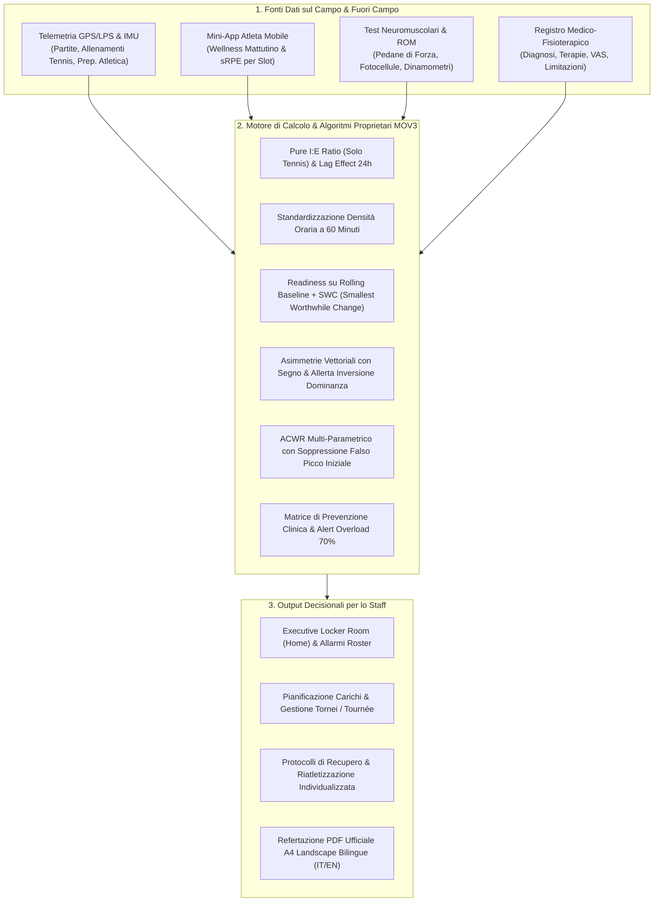

# MOV3 ANALYTICS ENTERPRISE
## Piattaforma Scientifica di Performance Intelligence, Prevenzione Clinica e Match Analysis per il Tennis d'Élite
*Documento Tecnico-Operativo Ufficiale per Direzione Tecnica, Preparatori Atletici, Staff Medico e Academy*  
*Release di Riferimento: Novembre 2026*

---

## 1. Visione Strategica e Architettura Operativa dell'Ecosistema MOV3

**MOV3 Analytics Enterprise** nasce per risolvere il principale collo di bottiglia del tennis moderno ad alto livello: la frammentazione dei dati tra dispositivi eterogenei (telemetria GPS sul campo, pedane di forza in palestra, questionari compilati dagli atleti, cartelle cliniche e referti fisioterapici).

Mentre tradizionalmente lo staff deve consultare fogli di calcolo disgiunti o dashboard proprietarie chiuse, MOV3 unifica l'intero percorso del tennista in una **cabina di regia decisionale integrata**:

### I Tre Pilastri Fondamentali del Sistema
1. **Oggettivazione del Carico Specifico del Tennis**: Superamento dei volumi generici grazie alla separazione del lavoro tecnico con la racchetta rispetto alla palestra e alla normalizzazione oraria a 60 minuti.
2. **Prevenzione Clinica Predittiva**: Integrazione stretta tra disponibilità sanitaria, trattamenti fisioterapici e vincoli di carico sul campo per evitare recidive e sovraccarichi.
3. **Usabilità Operativa Immediata**: Interfaccia ad alto contrasto visivo, bilingue (Italiano e Inglese) e strutturata con la **MOV3 Hero Strip** per mantenere sempre in evidenza l'atleta analizzato, i giorni dall'ultima attività e lo stato clinico in tempo reale.

---

## 2. Executive Locker Room (Home Page): Controllo Roster e Focus Atleta

La Home Page è concepita come la sala operativa della direzione tecnica e dei coach. Adotta una struttura gerarchica rigorosa:

### A. Roster Readiness & Panoramica Squadra
Nella parte superiore della pagina, una tabella riassuntiva espone la situazione di tutti i tennisti del team o dell'accademia:
- **Stato Dati**: giorni trascorsi dall'ultima attività registrata (con evidenziazione se la seduta è reale o simulata).
- **Readiness a 2 Giorni (Carico Acuto)**: rapporto percentuale tra il lavoro svolto negli ultimi due giorni e la baseline di riferimento, con indicazione visiva dello stato di freschezza o affaticamento.
- **Carico Rolling a 7 Giorni**: volume complessivo accumulato nell'ultima settimana rispetto alla media abituale.
- **Settimana di Calendario (Lun–Dom)**: volume totale e numero di sessioni completate nella settimana in corso.

### B. Focus Singolo Atleta (1-Click Selection)
Sotto la panoramica del team, lo staff seleziona con un clic il singolo tennista per analizzarne i dettagli:
- **Card Stato Clinico & Operativo**: sincronizzata con l'area medica, certifica istantaneamente se il giocatore è in regime di *Disponibile / Full Training*, *Carico Adattato* (con programma modificato) oppure *Stop Medico*.
- **Card Ultimo Trattamento Fisioterapico**: espone data dell'ultima seduta sanitaria, tecnica applicata (es. Terapia Manuale, Osteopatia, Tecar, Dry Needling), distretto anatomico trattato e scala del dolore VAS (0–10).
- **Pulsanti di Navigazione Rapida**: scorciatoie dirette verso Trend Settimanale, Analisi Sessione, Analisi Match e Benchmark Roster per quell'atleta.

### C. Trend Carichi Rolling a Due Scale (Ultimi 30 Giorni)
Grafico interattivo a doppio asse verticale indipendente che svela discrepanze critiche tra volume e intensità:
- **Asse Sinistro (Barre Scure)**: Volume complessivo espresso in *Training Load* (AU).
- **Asse Destro (Curva Ciano)**: Intensità neuromuscolare espressa in *Training Load High* (AU).
- **Perché serve nel tennis**: Una seduta pre-gara di soli 50 minuti focalizzata su servizi massimali e partenze esplosive produce un Training Load moderato ma un TL High altissimo. Il doppio asse impedisce che l'intensità venga schiacciata dal volume, evidenziando all'istante le giornate ad alto stress neuromuscolare.
- **Indicatori Chiave**: Volume Totale 30gg, TL High Totale, Rapporto Intensità/Volume (%) e Giorni di Attività su 30gg.

---

## 3. Calendario Master & Area Medica: Trattamenti e Prevenzione

Questo modulo colma il divario tra staff atletico e staff sanitario, trasformando il calendario in un diario integrato di carico e clinica.

### A. Master Timeline & Day Inspector
- **Vista Mensile e Giornaliera**: Ciascun giorno del calendario mostra con badge chiari il tipo di attività svolta (Match, Tennis, Palestra, Trattamento Fisioterapico, Giorno di Riposo o Viaggio).
- **Day Inspector**: Cliccando su un giorno, un pannello laterale isola tutti gli eventi: sessioni GPS, sRPE, dati del wellness mattutino, esito dei test fisici e note sanitarie.
- **Ponte NO-GPS verso il Generatore**: Quando un tennista disputa un match o una seduta senza GPS (es. trasferta o palestra), il Day Inspector offre un pulsante per trasferire atleta, data e minuti direttamente al simulatore per stimare il carico mancante ed evitare buchi nella serie storica.
- **Duplicazione Rapida Trattamento**: I fisioterapisti possono ripetere un trattamento terapeutico con un solo clic impostando la nuova data, senza dover ricompilare l'intera scheda clinica.

### B. Allerta Tetto 70% in Regime di "Carico Adattato"
Quando un tennista presenta un risentimento e lo staff medico ne imposta lo stato su **Carico Adattato**:
- Il sistema calcola automaticamente la media storica del Training Load del giocatore.
- Fissa un **tetto prudenziale invalicabile pari al 70%** di tale media.
- Se l'atleta supera questa soglia sul campo, scatta un badge di allerta immediato (`[OVERLOAD >70% MEDIA]`) visibile nel Calendario, nel Day Inspector e nella Card Clinica della Home.
- Nel grafico di correlazione carichi/clinica viene tracciata una linea orizzontale di sicurezza per monitorare visivamente che nessuna barra superi il limite durante il periodo di cautela.

### C. Matrice di Prevenzione Trattamenti a Lungo Termine (>90 Giorni / Storico)
Dedicata ai responsabili dell'area medica, aggrega l'intera storia clinica del tennista su orizzonti temporali ampi (90gg, 180gg, 365gg o Storico Completo):
- **Tabella per Distretto Anatomico e Lato (Dx/Sx)**: Numero complessivo di sedute, frequenza media (in giorni) tra un trattamento e l'altro, prima e ultima data di intervento.
- **Classificazione della Ricorrenza**:
  - `[CRITICO / RICORRENTE]`: 5 o più sedute complessive o 3 o più nell'ultimo mese sullo stesso distretto (es. spalla destra o tendine rotuleo).
  - `[MONITORARE]`: 3–4 sedute nel periodo.
  - `[ROUTINE]`: 1–2 sedute occasionali.
- **Archivio Dettagliato**: Storico cronologico filtrabile per data, operatore, tecnica terapeutica e variazione della scala VAS prima e dopo il trattamento.

---

## 4. Test Fisici, Neuromuscolari & Valutazioni: Panoramica e Modelli Matematici

Il modulo gestisce la profilazione funzionale (pedane di forza, fotocellule, dinamometria e test da campo) e introduce un'architettura a 6 schede operative.

### A. Scheda "Panoramica Test Atleta" (Macro Card & Trend)
La prima scheda del modulo fornisce una sintesi visiva ed esecutiva per l'atleta selezionato:
- **Indicatori Globali**: Numero di protocolli eseguiti, totale misurazioni storiche, data dell'ultimo test e indice medio di efficienza rispetto ai Personal Best.
- **Macro Card per Singolo Test**: Per ogni test che il giocatore ha svolto nello storico, una scheda dedicata riporta:
  1. **Numero di Rilevazioni**: quante volte l'atleta è stato testato su quel protocollo.
  2. **Best dell'Atleta (Personal Best)**: valore record con data esatta in cui è stato conseguito.
  3. **Ultima Misurazione**: valore più recente, data del test e **percentuale di rendimento rispetto al Personal Best** corredata da delta percentuale e stato di forma.
  4. **Mini-Grafico Cronologico Incorporato (Sparkline)**: tracciato dell'andamento nel tempo con i punti di rilevazione, le date e una linea orizzontale di riferimento sul Personal Best.
- **Filtri & Switcher**: Possibilità di filtrare per macro-area (Salto, Forza, Velocità, Mobilità), cercare per nome protocollo o passare alla visualizzazione tabellare compatta.

### B. Readiness basata su Rolling Baseline + SWC (Smallest Worthwhile Change)
Nei test longitudinali, confrontare un risultato solo con il record assoluto è fuorviante a causa delle normali oscillazioni biologiche:
- MOV3 calcola la **media recente** ($\mu$) sulle ultime 5 sessioni e la **deviazione standard** ($\sigma$).
- Fissa la soglia di cambiamento minimo significativo:
  $$\text{SWC} = 0.2 \times \sigma \quad (\text{con fallback prudenziale al } 2.5\% \times \mu \text{ se } \sigma = 0)$$
- **Fasce di Giudizio Funzionale**:
  - *Ottimale*: Valore superiore a $\mu + \text{SWC}$ o entro il 3% dal Personal Best assoluto.
  - *Stabile / In Target*: Valore compreso nella banda di oscillazione fisiologica $[\mu - \text{SWC}, \mu + \text{SWC}]$.
  - *Attenzione / Lieve Calo*: Valore compreso tra $\mu - \text{SWC}$ e $\mu - 2\cdot\text{SWC}$.
  - *Critico / Sotto Soglia*: Valore peggiore di $\mu - 2\cdot\text{SWC}$ (calo statisticamente reale di forza o reattività).

### C. Asimmetria Vettoriale con Segno & Allerta "Direction-Switch"
Nelle prove unilaterali (es. salti monopodalici SL-CMJ, forza eccentrica hamstring o forza rotatori spalla), le formule prive di segno mascherano la direzione dello squilibrio:
- MOV3 applica la formula vettoriale con segno:
  $$\text{Asym}_{\text{signed}} = \left( \frac{\text{Dx} - \text{Sx}}{\max(\text{Dx}, \text{Sx})} \right) \times 100$$
  *(il segno $+$ indica sempre dominanza prestativa Destra, il segno $-$ Sinistra)*.
- **Alert Inversione di Dominanza**: Se tra due sessioni consecutive il segno dell'asimmetria si inverte superando la soglia del $\pm 4\%$ (es. da $+6\%$ arto destro a $-7\%$ arto sinistro), scatta l'allarme `[INVERSIONE LATO DOMINANTE]`, indice primario di compenso biomeccanico o dolore latente.
- **Grafico Centrato sullo Zero**: Visualizzazione con linea dello 0% al centro, fascia verde di simmetria fisiologica ($\pm 10\%$), fascia ambra di cautela ($\pm 10-15\%$) e soglie rosse di allarme oltre il $\pm 15\%$.

### D. Indici Biomeccanici Derivati Cross-Test (Stessa Data)
Quando nella stessa data sono registrati più test, il sistema genera automaticamente 4 indici integrati:
1. **Elastic Utilization Ratio (EUR)**: Differenziale tra CMJ e Squat Jump ($\text{CMJ} - \text{SJ}$) in centimetri e in percentuale ($\frac{\text{CMJ} - \text{SJ}}{\text{SJ}} \times 100$). Valuta la capacità di sfruttare il ciclo stiramento-accorciamento (SSC), fondamentale per lo split-step e i cambi di direzione.
2. **Dynamic Strength Index (DSI)**: Rapporto tra il picco di forza dinamico nel salto e il picco isometrico all'IMTP ($\text{DSI} = \frac{\text{Peak Force Salto}}{\text{Peak Force IMTP}}$). Target ottimale: $0.60 - 0.80$. Se inferiore a 0.60, l'atleta necessita di lavoro balistico ed esplosivo; se superiore a 0.80, occorre sviluppare la forza massima di base.
3. **Change of Direction Deficit (COD Deficit)**: Differenziale temporale tra il test 5-0-5 Agility e lo sprint lineare sui 10 metri. Isola la pura capacità di frenata e cambio di verso dalla velocità di corsa in rettilineo.
4. **Mobilità e Ratios Spalla**: Dal test sui rotatori calcola il TROM (*Total Range of Motion* = Intrarotazione + Extrarotazione) e il rapporto di forza ER/IR, prevenendo squilibri tipici del braccio dominante nel servizio.

---

## 5. Carico Interno (sRPE), Pure I:E Ratio & Lag Effect a 24 Ore

Il monitoraggio del carico interno integra la percezione soggettiva dello sforzo con il dato oggettivo dei sensori.

### A. Pure Internal:External Ratio (Isolato sul Tennis)
Nelle discipline di racchetta, un tennista svolge spesso sessioni doppie (campo al mattino, palestra pesi al pomeriggio). Sommare l'sRPE della pesistica al Training Load del GPS distorcerebbe il rapporto tra carico interno ed esterno:
- MOV3 calcola l'**I:E Ratio puro** esclusivamente nei giorni e negli slot in cui è presente una seduta con tipologia `Tennis` associata al tracciamento GPS.
- Esclude automaticamente gli slot di pesistica e preparazione atletica non monitorati via GPS.
- **Allerta Disaccoppiamento**: Se il rapporto I:E su campo supera del **20%** la media abituale del giocatore, il sistema segnala la giornata con un marker evidenziato nel grafico triassiale Plotly. Indica che per erogare la medesima corsa sul campo, il tennista ha percepito una fatica cardiocircolatoria o metabolica marcatamente superiore (spia precoce di mancato recupero, disidratazione o malattia latente).

### B. Lag Effect a 24 Ore (Carico Serale vs Risveglio Mattutino)
Spesso l'effetto di una partita o di un allenamento durissimo non si manifesta la sera stessa, ma la mattina seguente:
- L'algoritmo **Lag Effect 24h** correla automaticamente i picchi di carico interno ed esterno registrati al giorno $T$ con i parametri del questionario wellness (in particolare **DOMS** - indolenzimento muscolare e **Fatica**) registrati al risveglio del giorno $T+1$.
- Fornisce allo staff la quantificazione media di quanto salgono i DOMS e la spossatezza dopo carichi acuti elevati, consentendo di calibrare il riscaldamento e l'intensità del giorno successivo.

---

## 6. Match Analysis & Storico Partite: Superfici e Densità Oraria

La valutazione delle partite di tennis presenta due problemi metodologici unici: la forte disparità di durata tra gli incontri e l'influenza radicale della superficie di gioco.

### A. Filtro Superficie di Riferimento
Confrontare le prestazioni di una partita su Terra Rossa con la media generale di tutta la stagione è scorretto, poiché su terra gli scambi sono più lunghi e la decelerazione in scivolata produce impronte biomeccaniche diverse rispetto al cemento o all'erba:
- Nei moduli **Analisi Match** e **Storico Match**, lo staff può impostare il filtro per superficie (*Terra Rossa*, *Cemento Outdoor*, *Cemento Indoor*, *Erba*).
- Le medie storiche di riferimento e i delta percentuali vengono ricalcolati **esclusivamente sui match disputati sulla medesima superficie**, garantendo un benchmark rigoroso e contestualizzato.

### B. Densità Oraria Standardizzata su 60 Minuti
Una partita vinta 6-2 6-1 in 65 minuti produrrà sempre un volume totale inferiore rispetto a una battaglia di 3 ore terminata al terzo set, pur potendo avere un'intensità al minuto nettamente superiore:
- MOV3 introduce la **Normalizzazione a 60 Minuti di Gioco**:
  $$\text{Valore}_{60\text{m}} = \left( \frac{\text{Valore Totale Match}}{\text{Minuti Effettivi di Gioco}} \right) \times 60$$
- Questo calcolo viene applicato sia ai volumi generali (Training Load, TL High, Accelerazioni e Decelerazioni ad alta intensità, Azioni intense $>2''$) sia alle metriche GPS outdoor (*Distanza Totale percorribile in 60 min*, *Distanza in Potenza Metabolica HML $>25.5\text{W}$* e *VHML $>50\text{W}$*).
- **Vantaggio Operativo**: Consente di confrontare immediatamente la "densità energetica" di partite di durata diversa, identificando se nei match lunghi il calo è stato quantitativo (durata) o qualitativo (intensità e frenate all'ora). Nello Storico Match, un toggle interattivo permette di visualizzare l'intera timeline storica convertita in valori orari.

---

## 7. Analisi del Carico Longitudinale: Trend Settimanale, Stagionale & ACWR

Il monitoraggio del medio-lungo termine protegge il tennista dagli infortuni tipici della stagione agonistica itinerante.

### A. Selettore ACWR Multi-Parametrico a Curva Singola
Nel modulo **Trend Stagionale**, l'Acute:Chronic Workload Ratio (rapporto tra fatica acuta e forma cronica consolidata) può essere esplorato su tre dimensioni specifiche tramite selettore rapido:
1. **ACWR Globale (Training Load)**: panoramica complessiva del volume di lavoro.
2. **ACWR Meccanico (High Accel + High Decel IMU)**: misura specifica dello stress osteo-articolare e muscolare eccentrico, cruciale per prevenire patologie tendinee quando si passa dalla terra al cemento.
3. **ACWR Alta Intensità (Training Load High)**: monitoraggio dei picchi neuromuscolari.
- Il grafico espone una curva alla volta per mantenere la massima leggibilità, inserita sulle 4 zone di rischio fisiologico: *Scarico (<80%)*, *Sweet Spot (80–125%)*, *Attenzione (125–150%)* e *Sovraccarico (>150%)*.

### B. Soppressione del Falso Picco Iniziale (Burn-in Masking)
A inizio stagione, dopo una pausa di tornei o a seguito di uno stop per infortunio ($>28$ giorni), la media cronica dei 28 giorni precedenti è quasi nulla. Dividere il carico dei primi giorni per un valore vicinissimo a zero generava uno spike matematico fittizio (es. ACWR $>3.5$), che distorceva la scala del grafico e inviava falsi allarmi allo staff:
- **Media Progressiva Reale nei Primi 14 Giorni**: Durante le prime due settimane di ripresa, il denominatore cronico viene calcolato dividendo per i giorni effettivi trascorsi dall'esordio anziché dividere rigidamente per 28.
- **Mascheramento dei Primi 7 Giorni (Burn-in Masking)**: La curva grafica parte visivamente dall'ottavo giorno, azzerando i primi 7 giorni di avviamento per mostrare valori stabili, fisiologici e privi di artefatti matematici.

---

## 8. Analisi Medie & Confronti: Periodi Personalizzati per Tournée e Blocchi di Carico

Nel modulo **Analisi Medie e Confronti**, la valutazione del roster supera il limite rigido delle sole settimane solari di calendario (Lun–Dom).

### Selezione a Piacere del Periodo Temporale (Ranking & Distribuzione)
Nelle sezioni *Ranking Roster Atleti* e *Distribuzione Lavoro Roster*, lo staff può commutare tra:
- **Singola Settimana**: navigazione classica anno/settimana.
- **Periodo Personalizzato**: selezione libera di una data di inizio e fine periodo tramite calendario.
- **Perché serve nel tennis**: I tornei professionistici e le tournée internazionali non seguono il calendario solare (es. due settimane consecutive di tornei in Sudamerica, 10 giorni di blocco di carico invernale, una trasferta asiatica).
- **Ridenominazione Dinamica**: Attivando il periodo personalizzato, l'interfaccia aggiorna automaticamente tutti i titoli in **`PERIODO SELEZIONATO — RANKING ROSTER ATLETI`** e **`PERIODO SELEZIONATO — DISTRIBUZIONE DEL LAVORO (TEMPO)`**, commutando le etichette del podio da `WEEK BEST` a **`PERIODO BEST`**.

---

## 9. Mini-WebApp Mobile per gli Atleti e Refertazione PDF

### A. Mini-WebApp Mobile per Smartphone
Progettata per azzerare l'attrito di compilazione e consentire ai tennisti di inserire i dati in trasferta in meno di 30 secondi:
- **Wellness Mattutino (Pre-Colazione)**: 5 cursori rapidi su scala 1–10 per Qualità del Sonno, Livello di Energia, Fatica Generale, Indolenzimento Muscolare (DOMS) e Stress Mentale. Alimenta in tempo reale la dashboard dello staff prima dell'inizio degli allenamenti.
- **Carico Interno per Slot (sRPE)**: Al termine di ogni sessione (Tennis, Partita, Preparazione Fisica o Palestra), l'atleta seleziona i minuti effettivi e la fatica percepita sulla scala di Borg CR-10. Salva istantaneamente il dato su Supabase ed etichetta correttamente la seduta per il calcolo del Pure I:E Ratio.
- **Switch Bilingue IT/EN**: Interfaccia fruibile sia da atleti italiani sia da tennisti stranieri.

### B. Motore di Refertazione PDF Ufficiale
Tutti i moduli includono una barra delle azioni per esportare referti professionali in formato **A4 Landscape**:
- Generati tramite motore vettoriale nativo ReportLab;
- Grafica executive allineata all'interfaccia con esagoni di performance, tabelle di scostamento e bande di rischio;
- Traduzione automatica dell'intero documento in base alla lingua selezionata a schermo.

---

## 10. Sintesi dell'Ecosistema Tecnologico e Matrice dei Ruoli (RBAC)

L'accesso alle funzionalità della piattaforma è regolato da un sistema di permessi basato sui ruoli (*Role-Based Access Control*), garantendo la privacy dei dati sensibili e la chiarezza operativa per ciascuna figura professionale:

| Modulo Funzionale | Super-Admin / Direzione | Preparatore Atletico | Fisioterapista / Medico | Coach Tennis | Atleta (Mobile) |
| :--- | :---: | :---: | :---: | :---: | :---: |
| **Executive Locker Room (Home)** | Vista Completa | Vista Completa | Vista Clinica & Carichi | Vista Completa | Accesso Negato |
| **Calendario & Area Medica** | Lettura / Scrittura | Lettura / Scrittura | Lettura / Scrittura | Sola Lettura | Accesso Negato |
| **Panoramica Test & Trend Atleta** | Vista Completa | Vista Completa | Sola Lettura | Sola Lettura | Accesso Negato |
| **Inserimento Test & Custom Builder** | Abilitato | Abilitato | Disabilitato | Disabilitato | Accesso Negato |
| **Carico Interno & Wellness** | Vista Completa | Vista Completa | Vista Completa | Vista Completa | Accesso Negato |
| **Match Analysis & Storico Partite** | Vista Completa | Vista Completa | Sola Lettura | Vista Completa | Accesso Negato |
| **Trend Settimanale & Stagionale** | Vista Completa | Vista Completa | Sola Lettura | Vista Completa | Accesso Negato |
| **Benchmark Roster & Periodi** | Vista Completa | Vista Completa | Sola Lettura | Vista Completa | Accesso Negato |
| **Mini-WebApp Smartphone** | Test / Monitor | Monitoraggio | Monitoraggio | Monitoraggio | Compilazione Guidata |

---
*MOV3 S.r.l. — Proprietà Intellettuale Riservata — Release Esecutiva Novembre 2026*
